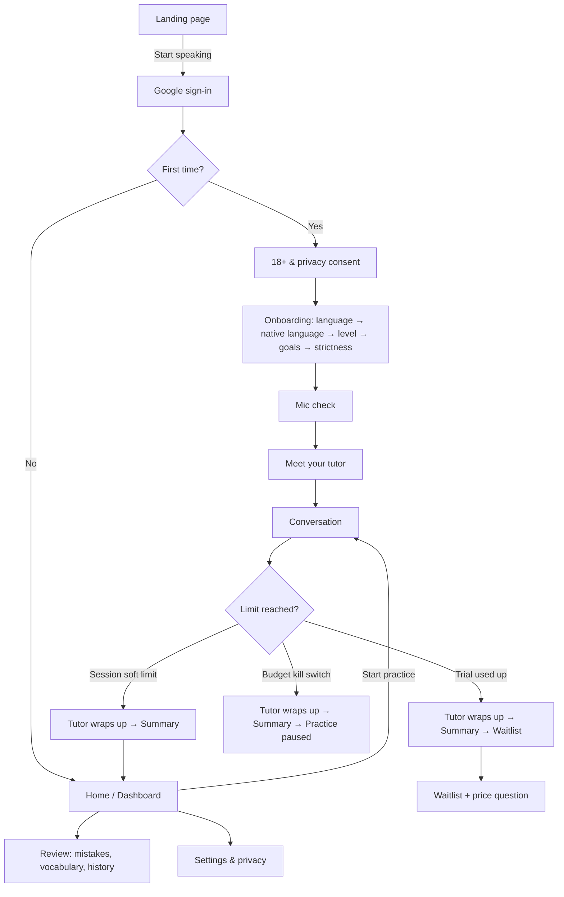

# 02 — User Journeys & UX Specification

> Related: [01 Product requirements](01-product-requirements.md) · [03 Design system & avatar spec](03-design-system-and-avatar-spec.md) · [06 Tutor behaviour](06-ai-tutor-behavior.md) · [07 State machine](07-conversation-state-machine.md)

Placeholders used throughout: app name **"Lactice"** (`NEXT_PUBLIC_APP_NAME`; logo still placeholder), tutors **Yuki** (Japanese), **Lena** (German), **Sam** (English). All are replaceable without code changes (names live in the tutor config, see [05 §6](05-voice-and-speech-architecture.md)).

---

## 1. UX principles

1. **The conversation is the product.** Every screen exists to get the learner into a conversation quickly or to make the next one better.
2. **Speaking first, reading as support.** Audio and the avatar lead; text (transcript, translation, furigana) is always one tap away but never required.
3. **Honest and kind.** When the system doesn't understand, it says so warmly. It never fakes understanding and never blames the learner ("I didn't catch that" — not "You said it wrong").
4. **One thing at a time on mobile.** The learner should always know the single next action (usually: tap the mic).
5. **Playful, not childish.** Rounded shapes, lively micro-animations and a cartoon tutor — but adult copywriting and no infantilising rewards.
6. **Fast perceived response.** Every tap gets an immediate visual response (≤100 ms) even when the AI takes 2–3 s.

---

## 2. Primary user journey



### 2.1 Returning learner (typical day)

Open app → Dashboard shows "Continue with Yuki" + 3 suggested topics (one tied to a recurring mistake) → tap a topic → conversation starts with the tutor's greeting → 5 minutes → summary → dashboard updates.

**Target: from opening the app to the tutor's first word in ≤ 2 taps and ≤ 5 s.**

---

## 3. Screen inventory

| # | Screen / state | Route | Section |
|---|---|---|---|
| 1 | Landing | `/` | §4.1 |
| 2 | Sign-in, consent, onboarding | `/signin`, `/onboarding/*` | §4.2 |
| 3 | Target language selection | `/onboarding/language` | §4.3 |
| 4 | Level self-assessment | `/onboarding/level` | §4.4 |
| 5 | Goals & personalisation | `/onboarding/goals` | §4.5 |
| 6 | Tutor introduction | `/onboarding/tutor` | §4.6 |
| 7 | Conversation | `/practice/[sessionId]` | §5 |
| 8 | Listening / speaking / processing / interruption states | (conversation) | §5.3 |
| 9 | Unclear-speech & retry states | (conversation) | §5.4 |
| 10 | Correction & explanation | (conversation) | §5.5 |
| 11 | Hints & suggested responses | (conversation) | §5.6 |
| 12 | Vocabulary & grammar review | `/review` | §6.2 |
| 13 | Lesson (session) completion & feedback | `/practice/[sessionId]/summary` | §6.1 |
| 14 | Dashboard & progress | `/home` | §6.3 |
| 15 | History & recurring mistakes | `/history`, `/review/mistakes` | §6.4 |
| 16 | Account, waitlist, settings, privacy | `/settings`, `/waitlist` | §6.5 |
| 17 | Loading, empty, error, offline, paused | (global) | §7 |
| — | Admin | `/admin` | §6.6 |

---

## 4. Pre-conversation screens

### 4.1 Landing

- **Hero (mobile, above the fold):** the three tutors standing together (idle animation, blinking), headline "Speak a new language with a tutor who actually listens.", sub-line "Japanese · German · English. 5-minute conversations. Honest corrections.", primary button **Start speaking — free**.
- **Section 2 — "How it works"**: 3 cards: *Pick a topic* → *Talk with your tutor* → *See what to fix*.
- **Section 3 — "Trust" differentiator**: a short animated example: learner bubble with "(unclear audio)" → tutor "Sorry, I didn't catch that — could you say it again?" Caption: "If it doesn't understand you, it says so. No fake corrections."
- **Section 4 — Meet the tutors**: one card per tutor with a 5-second voice sample (play button; respects autoplay rules — only plays on tap).
- **Footer**: privacy notice, terms, contact.
- No pricing section in MVP (waitlist only).

### 4.2 Sign-in & consent

1. **Sign-in**: single "Continue with Google" button; short line "We only use your name and email."
2. **Age gate (first time only):** "What's your date of birth?" — neutral date picker, no pre-fill, no hint of the cut-off. Under 18 → "Sorry — Lactice is for adults only for now." and sign out; nothing is stored. Only an "18+ confirmed" flag is kept, never the DOB ([14 §3.1](14-security-and-privacy.md)).
3. **Privacy & consent (first time only)** — a single card, notice available in English and Hindi:
   - Plain-language summary inline (what we collect, why, processors and that AI processing happens outside India, retention, how to delete) + link to the full notice.
   - Checkbox (required): "I agree to the Privacy Notice and Terms."
   - Toggle (optional, off): "Help improve the tutor — keep my voice recordings for 30 days."
   - Toggle (optional, off): "Share anonymous usage analytics."
   - Button: **Continue**. Stores each consent with version + timestamp ([14 §3.3](14-security-and-privacy.md)).

Onboarding is a 5-step flow with a top progress bar (dots), Back on every step, and state saved after each step (resume if the user leaves).

### 4.3 Target language

Three large tappable cards (flag-free — use the tutor portrait + language name in that language and English: "日本語 Japanese", "Deutsch German", "English"). Selecting a card shows a short tutor greeting bubble (text + optional play).

Then **native language**: searchable select with common Indian languages first (Hindi, Bengali, Marathi, Telugu, Tamil, Gujarati, Kannada, Malayalam, Punjabi, Odia, Urdu, English, Other). Helper text: "We'll use this to personalise your practice in future. Explanations are in English for now."

### 4.4 Level self-assessment

- Prompt: "Which sounds most like you in {language}?"
- 4 stacked cards (3 for English) with plain can-do statements derived from CEFR descriptors (exact wording in [08 §2](08-language-learning-engine.md)). Example for Japanese:
  - **Just starting (A1)** — "I can say hello, introduce myself and answer very simple questions slowly."
  - **Basic (A2)** — "I can talk about my daily routine, family and shopping in short sentences."
  - **Intermediate (B1)** — "I can describe experiences and plans and keep a simple conversation going."
  - **Upper-intermediate (B2)** — "I can discuss many topics with some detail and explain my opinion."
- Note under cards: "Not sure? Pick the lower one — your tutor adjusts as you talk."

### 4.5 Goals & personalisation

- "Why are you learning {language}?" multi-select chips: Work/career · Study abroad · Moving abroad · Exams · Travel · Culture & media · Friends/family · Just for fun.
- "How should your tutor correct you?" — 3 options with example previews:
  - **Relaxed** — "Only mistakes that change the meaning."
  - **Balanced (recommended)** — "Important mistakes, gently."
  - **Strict** — "Most mistakes, including small ones."
- For Japanese A2+: "Show furigana over kanji?" (default on).

### 4.6 Mic check & meet your tutor

**Mic check**: big mic button "Tap and say: 'Hello!'"; live level meter; on success ✓ "Great, I can hear you." On failure, platform-specific help (see §7.4).

**Meet your tutor**: full-height tutor card, avatar plays a short intro animation (wave is post-MVP → use happy expression + bounce), speech bubble with 2-sentence intro in English + target-language greeting, voice plays after a tap ("Tap to hear Yuki"). Personality tags (e.g. "Patient · Curious · Loves food"). Button **Start my first conversation**.

---

## 5. Conversation screen (primary)

### 5.1 Layout — mobile (360–430 px wide, portrait)

```
┌─────────────────────────────────────┐
│ ←  Yuki · Ordering food      ⏱ 3:12 │  top bar: back (confirm end), topic, remaining time ring
│ 🎯 Ask for a recommendation   [⋯]   │  objective chip (collapsible), overflow: settings/strictness/end
├─────────────────────────────────────┤
│                                     │
│            ( AVATAR )               │  avatar stage: 38–45% of viewport height
│        expression + lip-sync        │  speaking indicator = soft ring pulse behind avatar
│                                     │
├─────────────────────────────────────┤
│ Yuki: おすすめは何ですか？            │  transcript panel (scrollable), latest message pinned
│       [▶ Replay] [🐢 Slow] [Aあ 訳]   │  per-message controls
│ You:  ラーメンをください。             │
│ ┌─ Correction ───────────────────┐  │  correction card (inline, under learner message)
│ │ … → …   Why? ▾   [Try again]   │  │
│ └────────────────────────────────┘  │
├─────────────────────────────────────┤
│  [💡 Hint]      ( 🎤 )      [■ Stop] │  control bar: hint (left), mic (centre, 72 px), stop (right)
│        Tap to speak                  │  state label under mic
└─────────────────────────────────────┘
```

- **Avatar stage**: centred, character height ≈ 85% of the stage. Background: soft illustrated scene matching the topic category (café, office, street, home — 6 generic backgrounds, optional in MVP; plain gradient fallback).
- **Transcript panel**: fills the remaining height; auto-scrolls to the newest message unless the user has scrolled up (then shows a "↓ New message" pill). Hide-text toggle collapses tutor text to "• • •" placeholders with Replay still available.
- **Control bar**: fixed to the bottom, respects safe-area insets. The mic button is the only primary-coloured element on screen.

### 5.2 Layout — tablet/desktop (≥ 900 px)

Two columns: left 45% avatar stage (sticky, vertically centred) + controls under the avatar; right 55% transcript with correction cards and the objective/progress panel at the top. Keyboard: **Space** = start/stop recording (when focus isn't in an input), **Esc** = stop tutor audio, **H** = hint, **R** = replay last tutor message, **S** = slow replay, **T** = toggle text.

### 5.3 Turn states (visual spec)

Each state maps to a state in the [state machine](07-conversation-state-machine.md). The mic button, label, avatar expression and indicators change together.

| State | Mic button | Label | Avatar | Other |
|---|---|---|---|---|
| Tutor speaking | Outline mic (pressable = interrupt) | "Yuki is speaking… tap 🎤 to answer" | `speaking` + visemes | Ring pulse synced to audio amplitude; Stop button enabled; current sentence highlighted in transcript |
| Waiting for learner | Filled primary mic, gentle breathing scale (1.0→1.04) | "Tap to speak" | `listening` (attentive idle) | Silence timer running (hidden) |
| Hint pulse (≥10 s silence) | as above | "Need a hint?" | `listening` with a small encouraging smile | Hint button pulses 3 times |
| Recording | Red stop-square inside mic, live waveform around button | "Listening… tap to send" + elapsed seconds | `listening` with head tilt; eyes on learner | Countdown appears at 25 s ("5 s left") |
| Uploading / processing | Disabled, spinner ring | "Thinking…" | `thinking` (eyes up, finger to chin optional) | Learner bubble appears immediately with "…" until transcript arrives |
| Interrupted by learner | Recording starts immediately | — | Cuts to `listening` | Tutor bubble marked "(stopped)" with Replay still available |
| Wrapping up | Disabled | "Wrapping up…" | `happy` | Timer ring full |
| Reconnecting | Disabled | "Reconnecting…" | `idle` (dimmed) | Banner at top (see §7) |

Perceived-latency rules: show the learner's bubble within 100 ms of tapping send; show the `thinking` expression immediately; start tutor audio with the first sentence (don't wait for the full reply).

### 5.4 Unclear speech & retry states

Driven by the classification described in [06 §4](06-ai-tutor-behavior.md).

| Situation | Learner bubble | Tutor response | UI |
|---|---|---|---|
| No speech detected (VAD) | Not added | Spoken: "I didn't hear anything — try again when you're ready." | Avatar `confused` → `listening`; mic tips: "Hold the phone closer" after the 2nd time |
| Partly understood (attempt 1) | Greyed bubble with the recognised fragment | "I heard 'ramen…' but not the rest — could you say it again?" (echoes the fragment) | `confused` → `listening` |
| Unclear (attempt 1) | Greyed "(I couldn't catch this)" — transcript hidden behind "Show what I heard" | "Sorry, I didn't catch that — could you say it again, maybe shorter?" (template, A1 shows English subtitle) | `confused` expression; retry counter not shown to user |
| Unclear (attempt 2 — only if `UNCLEAR_MAX_RETRIES` is raised to 2) | Same | Asks a **simpler, closed version** of the question: "OK — ramen or sushi, which do you like?" (not a plain "repeat please", which research shows works poorly) | Same + mic tip "Try a quieter spot or hold the phone closer" |
| Unclear (limit reached — default after 1 attempt) | Same | "No problem! You can say: 「…」" + moves on to a simpler question | Suggested-sentence card (2 options when possible) with Play and "Say it" (starts mic) |

The learner never sees a correction on an unclear turn. "Show what I heard" exists for transparency (and to build trust): it displays the raw transcript with a note "I wasn't confident about this."

### 5.5 Correction & explanation

```
You: 私はラーメンを食べたいです。昨日も行きます。
┌─ 💡 Something to fix ────────────────────────┐
│ 昨日も [行きます]                               │  error span highlighted, answer hidden first
│ Hint: it happened yesterday.                    │
│ [🎤 Try again]   [Show answer]   [⚑]            │
└──────────────────────────────────────────────┘
        ↓ after a try (or "Show answer")
┌─ 💡 Small fix ───────────────────────────────┐
│ 昨日も 行きます → 昨日も 行きました               │  diff highlight (strike → underline)
│ Past action → use the past form ～ました.        │  ≤ 15-word rule (English, level-adapted)
│ [Why? ▾]  [▶ Hear it]  [🎤 Try again]  [⚑]     │
└──────────────────────────────────────────────┘
```

- **Try again comes before the answer** (Balanced and Strict): prompting learners to self-repair is more effective than handing them the correct form. Relaxed mode shows the answer immediately ([06 §6](06-ai-tutor-behavior.md)).
- Card types and colours: **Fix** (genuine error, amber accent), **More natural** (optional alternative, blue accent, labelled "Optional"), **Nice!** (positive feedback for a previously recurring mistake now correct, green). Never red backgrounds — red is reserved for recording.
- "Why?" expands a 2–4 line explanation with one extra example.
- "Try again" starts recording for this card only; result shows ✓ "Perfect!" or a gentle second look; it does **not** count as a conversation turn.
- ⚑ opens "Was this correction wrong?" → options: "I said it correctly / You misheard me / Other". Feeds evaluation data (FR-35).
- Strictness changes how many cards appear, never their style.
- The spoken recast (if any) is in the tutor's next message, naturally ("Ah, 行きました! Where did you go?"), and the recast word is underlined in the transcript linking to the card.

### 5.6 Hints & suggested responses

Hint button opens a bottom sheet (doesn't cover the avatar's face on mobile — max 40% height):

1. **Hint** (1st press): idea in English — "Tell Yuki what food you like." + 2–3 keywords with readings (ラーメン ramen, 好き suki).
2. **Sentence starter** (2nd press): 「私は ___ が好きです。」 with Play.
3. **Full example** (3rd press): complete sentence with Play, translation, and **"Say it"** (mic).

Silence nudge at 25 s is spoken by the tutor and opens level 1 automatically. Hint usage is recorded per turn (progress signal, [08](08-language-learning-engine.md)).

### 5.7 Translation & script controls

- Per message: **訳 / Translate** icon shows translation beneath the text (Hindi for English track, English otherwise).
- Japanese: global toggles in overflow menu — furigana on/off (A2+), romaji on/off (A1 default on). Rendered with `<ruby>`.
- Long-press a word (mobile) / click (desktop) → mini dictionary popover: reading, meaning, "Save word".

### 5.8 Objective chip

Shows the tutor's current hidden language goal in learner-friendly form ("🎯 Ask for a recommendation"). Collapsible; ticks with a small celebration when the learner achieves it (detected by the evaluator, see [06](06-ai-tutor-behavior.md)). Optional for the Phase 2 PoC.

### 5.9 Ending a session

- Soft limit: timer ring fills; after the current exchange the tutor says a goodbye line; avatar `celebrating`; auto-navigate to summary after the audio ends (Skip button visible).
- Manual end: overflow → "End conversation" → confirm sheet "End now? You'll still get your summary." Sessions under 60 s of learner speech get a short summary without level update.

---

## 6. Post-conversation & account screens

### 6.1 Session summary

Order (top to bottom): celebration header with avatar `celebrating` and one-line praise → **Did well** (1–3 items) → **Fixes** (correction cards, collapsed, with Try again) → **New words** (with Save) → **Stats** (speaking time, turns, hints used) → **Level estimate** ("Estimated level: A2 — steady" or "moving up ↑", never a precise score) → buttons: **Practice again** · **Done**. If trial ended: **Done** leads to waitlist.

### 6.2 Vocabulary & grammar review (`/review`)

- Tabs: **Words** · **Mistakes**.
- Words: list with reading/meaning, source session, Play (TTS cached), remove. Filter by language.
- No flashcards/SRS in MVP (FR-46 later); "Practise these" button starts a conversation with those words as hidden goals.

### 6.3 Dashboard (`/home`)

- Header: tutor avatar (small, idle) + "Continue with Yuki" primary button.
- **Suggested topics** row (3 chips, one tagged "Fix: particles").
- **Progress card**: estimated level badge per skill (4 mini bars labelled Grammar/Vocabulary/Fluency/Comprehension, with "estimate" tooltip), minutes this week, sessions completed, mistakes fixed.
- **Recurring mistakes** (top 3) → link to full list.
- **Recent sessions** (last 3) → history.
- Trial users: remaining trial minutes chip.

### 6.4 History & recurring mistakes

- History: list grouped by date: topic, duration, tutor, #fixes. Detail = full transcript with corrections; delete session button.
- Recurring mistakes: grouped by category (e.g. "Particles: を vs に"), count, last seen, examples, "Practise this" button.

### 6.5 Settings, account, privacy, waitlist

- **Learning**: target language switch, level (manual override with note), strictness, furigana/romaji defaults, sound effects toggle, reduced motion (follows OS by default).
- **Privacy**: audio-retention opt-in toggle, "Download my data" (S priority), "Delete my history", "Delete my account" (typed confirmation), privacy notice, grievance contact.
- **Plan**: trial status; "Paid plans are coming soon" + waitlist status.
- **Waitlist screen**: avatar `happy`, "You've used your free practice! Paid plans are coming soon." Join button (email prefilled from Google, read-only) + optional "What would you pay per month?" chips ₹199 / ₹399 / ₹799 / Other (free text). Confirmation state.

### 6.6 Admin (`/admin`, allow-listed)

Cards: month-to-date AI spend vs `AI_MONTHLY_BUDGET_USD` (progress bar + per-provider split), sessions today/7d/30d, active users, average cost per session, p50/p90 turn latency, flagged sessions table (≥2 unclear loops, provider errors, correction reports) linking to transcript view, waitlist table with CSV export and price-answer histogram. Plain styling (no design-system polish needed).

---

## 7. Global states

### 7.1 Loading

- Route transitions: skeletons matching layout (cards, transcript rows), never blank screens.
- Conversation start: avatar loads first (cached SVG); while the session initialises, avatar is `idle` with label "Yuki is getting ready…". If > 4 s: "Still connecting…"; > 10 s: error state.

### 7.2 Empty states

Each with tutor illustration + one action: no history ("Your conversations will appear here — start your first one"), no saved words, no recurring mistakes ("No recurring mistakes yet. Nice!").

### 7.3 Errors & offline

| Condition | UI |
|---|---|
| Offline (navigator offline / fetch failures) | Top banner "You're offline — we'll reconnect automatically." Mic disabled. Session timer paused (D-23). |
| Provider failure (STT/LLM/TTS) after retries | Tutor bubble: "Sorry, I had a hiccup on my side. Let's try that again." + retry turn; after 2 consecutive failures: modal "Something's wrong on our end. Your conversation is saved." → End & see summary / Try again. |
| Session expired (> reconnect window) | "This conversation ended while you were away." → Summary of what was completed. |
| Budget kill switch | Full-screen friendly card: "Practice is paused for now — we've hit this month's limit. Back soon!" (no technical detail). |
| Rate limited | "Slow down a little — try again in a moment." |

### 7.4 Microphone problems

| Problem | Message |
|---|---|
| Permission denied (Chrome Android) | Steps with icons: tap 🔒 in address bar → Permissions → Microphone → Allow → reload. |
| Permission denied (iOS Safari) | Settings → Safari → Microphone → Allow, or "aA" menu → Website Settings → Microphone. |
| No input device / NotFoundError | "We can't find a microphone. Check it's connected and not used by another app." |
| Unsupported browser | "Your browser doesn't support voice recording. Please use Chrome or Safari." |

---

## 8. Sound & haptics

| Event | Sound (≤ 200 ms, soft) | Haptic (Android `navigator.vibrate`, where supported) |
|---|---|---|
| Recording starts | Soft rising "pop" | 10 ms |
| Recording sent | Soft falling "pop" | 10 ms |
| Correction card appears | None (avoid punishment association) | — |
| Try-again success | Light chime | 15 ms |
| Session complete | Short celebratory jingle (≤ 1.5 s) | 2 × 20 ms |

All sounds toggle off in settings; never play over tutor speech. iOS Safari doesn't support the Vibration API — haptics are progressive enhancement only.

---

## 9. Accessibility (WCAG 2.2 AA)

- Transcript acts as captions for all tutor speech; the live tutor message is announced via `aria-live="polite"` (only completed sentences, to avoid chatter).
- Mic button: `aria-pressed` and state labels ("Start recording", "Stop and send"); state changes announced.
- All controls reachable by keyboard with visible focus rings (3 px, ≥ 3:1 contrast). Shortcuts in §5.2 are documented in a "?" overlay and can be disabled.
- Touch targets ≥ 44×44 px (mic 72 px).
- Colour is never the only signal: corrections use icons + labels; diffs use strike-through + underline in addition to colour.
- `prefers-reduced-motion`: avatar keeps lip-sync and blinking but disables bounce, sway and celebration particles; transitions become fades ≤ 150 ms.
- Text scales to 200% without loss; Japanese ruby text min 10 px.
- Time limits: session soft limit is not a WCAG "timing" failure because it doesn't cut the user off mid-action; the summary is always available afterward.

---

## 10. Prototype & validation plan for UX

1. **Phase 1 (clickable)** — Figma (free) prototype of the conversation screen states in §5.3–5.6 at 390×844 and 1280×800. Test with 3–5 target learners using a "Wizard of Oz" voice (developer speaks as tutor) to validate: Is the mic action obvious? Are correction cards understood? Is the hint ladder discoverable?
2. **Phase 2 (functional PoC)** — real conversation screen only (no onboarding/dashboard), Japanese, one avatar. Measure turn latency, recovery behaviour, and observe 5 sessions with real learners.
3. Only after both: build onboarding, dashboard, review, settings.

UX acceptance for Phase 2 PoC: 4 of 5 testers start speaking without instruction within 10 s; 4 of 5 can explain what a correction card means; no tester reports feeling "stuck".
