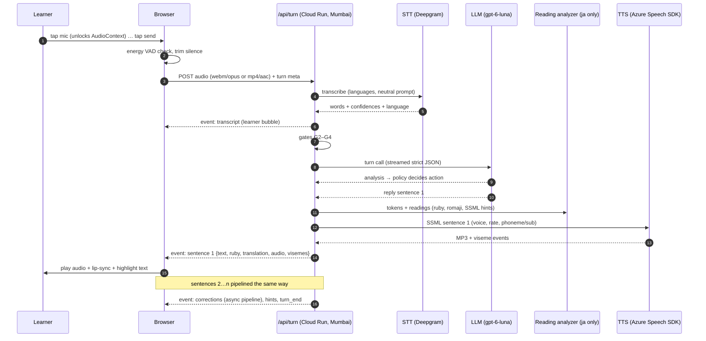

# 05 — Voice & Speech Architecture

> Related: [04 Providers](04-ai-provider-research.md) · [06 Tutor behaviour](06-ai-tutor-behavior.md) · [07 State machine](07-conversation-state-machine.md) · [11 Contracts](11-api-and-event-contracts.md) · Evidence: [TTS & voice](research/notes/tts-and-voice.md), [infra & browser audio](research/notes/infra-browser-privacy.md), [avatar & Japanese text](research/notes/avatar-lipsync-japanese-text.md)

---

## 1. End-to-end turn pipeline



### 1.1 Latency budget (target median ≤ 2.5 s from "send" to first tutor audio)

| Stage | Budget (p50) | Notes |
|---|---|---|
| Upload 5–10 s clip (≈ 20–40 KB at 32 kbps) on 4G | 150–300 ms | Opus 32 kbps; start upload immediately on send |
| STT | 400–800 ms | **Measure** from asia-south1 in Phase 0 |
| Gates + prompt assembly | ≤ 30 ms | Pure code |
| LLM TTFT (effort `none`) | 700–950 ms | **REPORTED** 0.74–0.94 s; schema warmed at deploy |
| Analysis tokens + first sentence tokens (~60 tokens at ~110–130 tok/s) | ~450 ms | Analysis is kept short (~40 tokens) |
| Reading analysis (ja) | ≤ 5 ms | Warm in-process singleton |
| TTS first audio (sentence 1) | 200–300 ms | Azure: vendor claims < 300 ms **VERIFIED as claim** |
| Download + decode + schedule | 100–200 ms | MP3 per sentence |
| **Total** | **≈ 2.0–3.0 s** | Tight against the 2.5 s median target → see mitigations |

Mitigations, in order: (1) keep sentence 1 short (prompt: "first sentence ≤ 8 words: a reaction"), (2) start TTS for the recast field as soon as it's complete (it precedes the sentences), (3) warm-up ping when the mic opens (cold-start hiding), (4) `POLICY_SINGLE_CALL` (one LLM call), (5) OpenAI Fast mode (2× price) only if p90 > 4 s.

---

## 2. Browser audio capture

| Concern | Decision |
|---|---|
| Permission | Request once per session via `getUserMedia({ audio: { echoCancellation: true, noiseSuppression: true, autoGainControl: true, channelCount: 1 } })`; reuse the `MediaStream`; stop tracks at session end. iOS honours only `echoCancellation` **VERIFIED** — fine. |
| iOS PWA quirk | Keep recording within a single client route — standalone web apps may re-prompt or stop the stream on navigation **REPORTED**. |
| Format | Feature-detect: `audio/webm;codecs=opus` (Chrome; iOS 18.4+) → else `audio/mp4` (AAC, older iOS). `audioBitsPerSecond ≈ 32000`. Upload as-is with correct filename/extension. |
| VAD | **Energy/RMS gate** (AudioWorklet or AnalyserNode): adaptive threshold from the first 200 ms noise floor; require ≥ 400 ms voiced frames; trim leading/trailing silence. Silero VAD (≈ 5 MB with ONNX runtime, reported iOS memory issues) is deferred — optional, Android-only, lazy-loaded later. |
| Level meter | Same analyser drives the waveform ring around the mic button. |
| Max length | 30 s auto-send (countdown from 25 s). |
| iOS audio session | `navigator.audioSession.type = 'play-and-record'` while recording, `'playback'` before tutor audio (iOS 16.4+) so the silent switch doesn't mute Web Audio **REPORTED** — feature-detect. |

---

## 3. Speech-to-text integration

- Provider behind `SttProvider` interface ([04 §8](04-ai-provider-research.md)); primary Deepgram Nova-3 (provisional) with `mip_opt_out=true`, model pinned.
- **Language hints:** target language + English (+ Hindi on the English track) so code-switching is transcribed, not translated.
- **Neutral prompt / no keywords** containing expected answers (error preservation).
- Output normalised to `{ text, words: [{ w, start, end, conf }], lang, langConf }`; confidences normalised to 0–1 (logprob → prob where needed; `null` = unknown → stricter gating).
- **Second opinion (optional flag):** on clips whose mean confidence is within the borderline band, transcribe with a second engine (Groq Whisper, ~$0.0003/clip) and treat disagreement on content words as `UNCLEAR_AUDIO`.
- Learner audio is processed in memory and **never written to disk or logs** unless the learner opted in (D-42); opt-in clips go to the private `learner-audio` bucket with a 30-day expiry.

---

## 4. Transport & playback

### 4.1 Transport

One `POST /api/sessions/{id}/turns` request per learner turn: multipart upload of the clip; the **response body is a stream** of length-prefixed binary frames (JSON event frames + MP3 audio frames), read with `fetch` + `ReadableStream` (Chrome Android 43+, iOS 10.3+ **VERIFIED**). SSE can't carry the upload and WebSockets add per-connection state on Cloud Run, so neither is used. Frame format in [11 §3](11-api-and-event-contracts.md).

### 4.2 Playback

| Concern | Decision |
|---|---|
| Live playback | Per-sentence **complete MP3 clips** (Azure `Audio24Khz48KBitRateMonoMp3`, ESTIMATE ≈ 0.3 MB per 50 s of speech) → `decodeAudioData` → back-to-back `AudioBufferSourceNode`s on one shared `AudioContext` (gapless, works on both browsers). |
| Unlock | On every mic tap: `audioCtx.resume()` + 1-sample silent buffer; prime one reusable `<audio>` element. Never create new contexts later (autoplay rules). |
| Not used | MSE (absent on iPhone; ManagedMediaSource only iOS 17.1+), raw PCM streaming (~6× bandwidth). |
| Interrupt | Stop all scheduled sources immediately; send `interrupted { turnId, playedMs }`. |
| Replay | Re-schedule cached decoded buffers (no network, no cost). |
| **Slow** | One `<audio>` element with a Blob of the concatenated sentence MP3s, `playbackRate = 0.75`, `preservesPitch = true` (Chrome Android 86+, iOS 17.2+; `webkitPreservesPitch` earlier) **VERIFIED**. Viseme timeline scaled by 1/0.75. $0 extra. Provider-side slow synthesis is reserved for short, cached drill phrases. |
| Cache | Decoded buffers + MP3 blobs in memory for the session; template and greeting audio in Cache Storage (service worker). |

### 4.3 Lip-sync wiring

Azure `VisemeReceived` events (viseme ID + audio offset in 100-ns ticks) are collected server-side per sentence and sent with the audio as a `VisemeTrack` (`[{ t: ms, v: VisemeId }]`) after mapping the 22 Azure IDs to our 10 mouth shapes ([03 §B6](03-design-system-and-avatar-spec.md), mapping table in the avatar research notes §1.3). The client schedules the track on `AudioContext` time minus `outputLatency` (fallback `baseLatency`) plus a user-adjustable offset (±200 ms, for Bluetooth headsets).

Fallbacks, in order: (1) if a locale/voice emits no visemes (ja-JP support is documented inconsistently — **day-1 test**), derive visemes from **word-boundary events + kana readings** (Japanese mora → viseme table) — (2) audio analysis of the decoded PCM ahead of playback (amplitude + 5-vowel formant classifier in a Worker) — (3) amplitude-only jaw.

---

## 5. Text-to-speech strategy

### 5.1 Provider & voice configuration (deterministic)

| Rule | Implementation |
|---|---|
| One voice per character, never switched | `TutorConfig.voice = { provider, voiceName, locale, rateByLevel, lexiconUrl, outputFormat }`, versioned and snapshotted into each session |
| Native voice per language | Candidates (blind test decides): ja — `ja-JP-NanamiNeural` / `AoiNeural` / `KeitaNeural`; de — `de-DE-KatjaNeural` / `ConradNeural` / `SeraphinaMultilingualNeural`; en — **en-US voices only** (D-49; e.g. 2–3 Azure en-US standard neural voices, chosen in the blind test) |
| Standard neural only | No `DragonHD…Latest` voices (no visemes/rate, floating model, deliberate variation) |
| Fixed prosody | Rate by level only (A1 −12%, A2 −6%, B1/B2 0% — tuned in the listening test); no per-turn emotion/style changes in MVP |
| Pinned everything | voice name, locale, output format, SDK version logged with every synthesis |

**Can one voice speak all three languages?** Vendors claim multilingual voices can; no independent evidence was found **REPORTED gap**. Since our tutors speak only the target language (D-15) and explanations are on-screen text, **one native voice per character is both sufficient and safer**.

### 5.2 Text preparation (before TTS)

1. **Sentence chunking:** each `reply.sentences[i]` (and `recast`) is one TTS request — 40–200 characters is the sweet spot for streaming latency vs prosody **ESTIMATE**.
2. **Normalisation (code):** numbers, dates, times, counters, currencies, units → spelled out or SSML `<say-as>`; German decimal commas and dates; Japanese counters with sound changes (一本 いっぽん, 三本 さんぼん), dates (一日 ついたち).
3. **Japanese readings:** the reading analyzer (kuroshiro + kuromoji, server-side, with an override dictionary — [§6](#6-japanese-text-pipeline)) produces tokens with readings. For tokens on the ambiguous-reading list (今日, 一日, 方, 行った, 上手, 家, 何…) or in the override dictionary, emit `<sub alias="かな">漢字</sub>` (or `<phoneme alphabet="sapi">` with katakana) so **audio and furigana agree**. Substitute only the ambiguous word, not the whole sentence (whole-kana input can hurt prosody **ESTIMATE**).
4. **Mixed-language segments:** a Japanese/German tutor quoting an English word keeps the **same voice** (a Japanese teacher saying "apple" sounds Japanese — acceptable); Hindi words from learners are transliterated or aliased. Never switch voice ID mid-utterance.
5. **Custom lexicon** per tutor (PLS, ≤ 100 KB, public URL) for recurring names/vocabulary.

### 5.3 Template & static audio

Greetings, recovery lines, nudges, closings and celebration lines are **pre-synthesised at deploy** (`npm run audio:build`) with the same voice config, stored in the public `tutor-static` bucket with their viseme tracks, and precached by the service worker. Benefits: zero latency, zero runtime cost, guaranteed consistency, recovery speech works when providers are down.

### 5.4 Failure handling

TTS first byte > 4 s or error → retry once → show text with "Audio unavailable — tap to retry", avatar runs a text-paced speaking animation. Two consecutive TTS failures in a session → modal per [07 §4](07-conversation-state-machine.md).

---

## 6. Japanese text pipeline

```mermaid
flowchart LR
    T[Tutor sentence text] --> A[kuroshiro + kuromoji tokens<br/>surface, reading, POS]
    A --> O[Override layer:<br/>curriculum dictionary · greetings 今日は→こんにちは ·<br/>numeral+counter normaliser · rendaku compounds]
    O --> F{Ambiguous / OOV token?}
    F -- yes, optional --> L[LLM verify reading<br/>JSON validated against surface]
    F -- no --> S
    L --> S[Structured tokens:<br/>s, r, ro (Hepburn), pos]
    S --> UI[Client renders ruby / romaji toggles]
    S --> SSML[SSML sub/phoneme for TTS]
```

- **Runs server-side** (17 MB dictionary; ~430 MB RSS — Cloud Run instance sized at 1 GiB) as a warm singleton; ~1 ms per sentence **VERIFIED in test**.
- **Known analyzer errors** (from testing): 一日中 → wrong rendaku; greeting 今日は read as きょうは; digits get no reading → the override layer fixes these classes; the curriculum dictionary grows from eval findings.
- **Romaji:** modified Hepburn with macrons (tōkyō), particles は→wa, へ→e, を→o.
- **Output** is structured tokens, not HTML, so toggles are client-side: A1 kana + romaji line; A2+ kanji with `<ruby>`; hiding furigana uses `rt { visibility: hidden }` (no layout jump). `<ruby>` is universally supported.
- **Learner transcripts** (STT output) get the same treatment for display.
- **Fonts:** M PLUS Rounded 1c / Noto Sans JP via `next/font`, Japanese routes only, `preload: false` (served as unicode-range slices — 124 per weight for Noto Sans JP **VERIFIED**).

---

## 7. Voice consistency strategy

Causes of drift and our mitigations (evidence in TTS notes §6):

| Cause | Mitigation |
|---|---|
| Voice not native to the language | Native voice per character (§5.1) |
| Random sampling / non-determinism | Azure standard neural voices (no temperature); measure bit-identity across calls in Phase 0 |
| Instruction-steered TTS varies between requests | Don't use instruction-steered TTS (gpt-4o-mini-tts) for characters |
| Model/voice version changes | Pin voice names; no "Latest" voices; regression suite before any upgrade |
| Long inputs degrade intonation | Sentence-level chunks |
| Bad text normalisation | Deterministic normaliser + `<say-as>` |
| Kanji misreadings | Reading analyzer + `<sub>`/`<phoneme>` + lexicon |
| Abrupt speed changes | Rate fixed per level for the whole session; Slow is client-side time-stretch |

---

## 8. Voice regression checks (automated, CI nightly on a fixed corpus)

| Metric | Tool | Flag when |
|---|---|---|
| ASR round-trip CER/WER (ja: kana-normalised CER) | Whisper turbo (MIT) locally | above per-language baseline + 2σ |
| Speaker-embedding similarity to the character's reference centroid | SpeechBrain ECAPA-TDNN (Apache-2.0) | below mean − 3σ of reference |
| Speaking rate (morae/s ja; syllables/s de/en) | analyzer + VAD trim | outside baseline ±10% |
| Median F0 | parselmouth/librosa | shift > 2 semitones |
| Determinism (5 generations of the same text) | embedding similarity + duration variance | variance above baseline |

Corpus per language (~40 lines): 15 typical tutor turns, 5 mixed-language, 5 numbers/dates, 10 kanji-ambiguity (ja) / compounds (de), 3 very short, 2 long.

---

## 9. Blind listening test (Phase 0 — before buying any voice subscription)

1. **Candidates per language:** 2–3 Azure standard voices, 2 ElevenLabs library voices (Flash v2.5 and v4 Turbo; use library voices with ≥ 365-day notice period), Google Chirp 3 HD and Neural2; optionally Deepgram Aura-2 (free credit) and Cartesia Sonic. All settings fixed and recorded.
2. **Stimuli:** ~12 lines per language from the §8 corpus, loudness-normalised (−23 LUFS), randomised, provider-blind IDs.
3. **Raters:** ≥ 3 native speakers (naturalness, accent, misreadings) + ≥ 3 Indian adult learners (intelligibility, likeability) per language.
4. **Tasks:** MOS 1–5 (naturalness, nativeness, pronunciation); "same speaker?" pairs (consistency); client-side 0.75× vs provider-slow comparison.
5. **Automatic metrics** on the same clips (§8) + time-to-first-audio from a server in Mumbai.
6. **Decision rule:** choose ElevenLabs over Azure only if its mean MOS is ≥ 0.5 higher on **both** panels and its pronunciation errors are not worse; otherwise choose the cheapest candidate within 0.25 MOS of the best. Reject any candidate with < 90% "same speaker" on its own pairs or an unfixable kanji misreading.
7. **Day-1 verifications:** Azure ja-JP and de-DE viseme events; whether Azure standard voices are bit-identical across calls; ElevenLabs Starter API-vs-credit accounting (if still a candidate).

Budget: ≈ 1 day + ≈ $10 of usage (free tiers + Deepgram credit).
