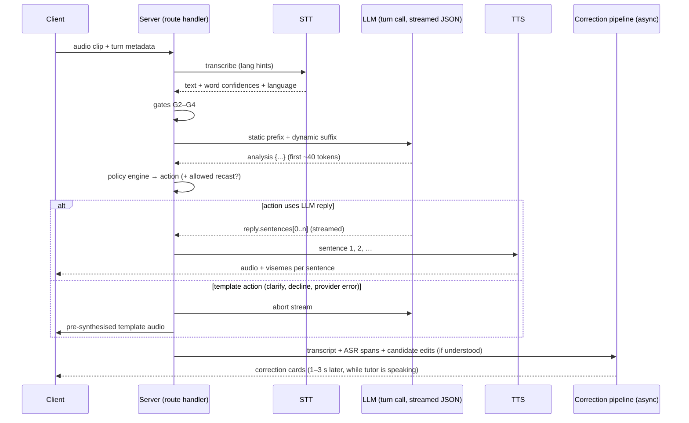
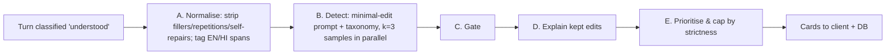

# 06 — AI Tutor Behaviour, Understanding & Correction Pipeline

> Related: [07 State machine](07-conversation-state-machine.md) · [08 Learning engine](08-language-learning-engine.md) · [05 Voice & speech](05-voice-and-speech-architecture.md) · Evidence: [pedagogy & reliability](research/notes/pedagogy-and-reliability.md), [STT & LLM](research/notes/stt-and-llm.md)

This document specifies how the tutor **understands**, **decides** and **speaks** — and, most importantly, how it avoids pretending to understand or inventing corrections. It is the technical core of the "trustworthy corrections" differentiator (D-09).

Evidence labels: **[E]** research-backed (see notes), **[A]** design assumption to validate, **[V]** verified vendor capability.

---

## 1. Division of responsibilities

| Concern | Owner | Why |
|---|---|---|
| Was there speech? Is the clip usable? | **Client VAD + server gates (code)** | Silence/short clips are the main trigger of STT hallucinations **[E]** |
| How confident is the transcript, word by word? | **STT confidence signals (code thresholds)** | Verbalised LLM confidence is systematically overconfident **[E]**; we never gate on it |
| What did the learner mean / which category is this turn? | **LLM classification (strict schema)**, checked by code | LLM is good at meaning; code enforces consistency with ASR evidence |
| What happens next (retry, hint, move on, wrap up)? | **Dialogue machine (code)** | Must be deterministic and testable ([07](07-conversation-state-machine.md)) |
| What exactly does the tutor say? | **LLM generation** for natural replies; **templates** for recovery lines | Natural conversation where it helps; zero-variance lines where reliability matters |
| Is something an error? Which errors are shown? | **Correction pipeline**: LLM detection with voting + deterministic gates | LLMs over-correct; precision needs external checks **[E]** |
| Level, recurring mistakes, progress | **Learning engine (code + end-of-session LLM pass)** | [08](08-language-learning-engine.md) |

**Rule of thumb:** the LLM may *propose*; only code may *decide* anything that affects counters, limits, what is flagged as an error, or what is stored as a learner fact.

---

## 2. Tutor characters (configuration, not prompt improvisation)

Each tutor is a versioned config file `content/tutors/{id}.ts`; the version is snapshotted into every session.

```ts
export const yuki: TutorConfig = {
  id: 'yuki-ja', version: 1, language: 'ja', name: 'Yuki',
  persona: {
    summary: 'Cheerful 26-year-old from Osaka who loves food and travel; patient, curious, gently playful.',
    traits: ['patient', 'curious', 'encouraging', 'never sarcastic'],
    interests: ['food', 'trains', 'anime', 'cafés'],      // used for small talk and "Surprise me"
    speakingStyle: 'Short, warm sentences. Uses です/ます. Reacts briefly (へえ！, いいですね！) before asking.',
    forbidden: ['romance/flirting', 'political opinions', 'claiming to be human'],
  },
  register: { default: 'polite', casualFrom: 'B1' },     // 08 §10
  voice: { provider: 'azure', voiceName: 'ja-JP-NanamiNeural', rateByLevel: { A1: '-12%', A2: '-6%', B1: '0%', B2: '0%' }, lexiconUrl: '…' }, // 05 §6
  avatar: { asset: 'ja-yuki', accent: '#F47FA4' },
  templates: 'content/templates/yuki-ja.yaml',           // recovery lines (§7)
};
```

Placeholder personas for the other tutors: **Lena** (de) — friendly Berliner, uses *du*, loves cycling and baking; **Sam** (en) — warm, upbeat American (en-US voice, D-49) who has lived in India and loves cricket and street food; models clear international English while treating Indian English features as valid (never corrected — [08 §3.3](08-language-learning-engine.md)).

The tutor **never claims to be human**; if asked, it says it's an AI tutor, in character.

---

## 3. Prompt architecture

Each tutor-turn call has a **static prefix** (cacheable, ≥ 1,024 tokens so prompt caching applies **[V]**) and a **dynamic suffix**.

```
┌──────────────── STATIC (cached per tutor × level × prompt version) ────────────────┐
│ 1. Role & persona (from TutorConfig)                                               │
│ 2. Teaching rules (one question per turn, never answer own question, level table)  │
│ 3. Register rules (08 §10) and Indian-English allowlist (en only)                  │
│ 4. Error taxonomy codes allowed at this level (from YAML) + minimal-edit rules     │
│ 5. Output schema description + 3 short few-shot examples (incl. unclear + L1 help) │
└────────────────────────────────────────────────────────────────────────────────────┘
┌──────────────── DYNAMIC (per turn) ────────────────────────────────────────────────┐
│ 6. Learner card: name, level per skill, strictness, top 2 recurring mistakes       │
│ 7. Session: topic, hidden goals (achieved?), simplify-mode flag, wrap-up flag      │
│ 8. Conversation window: rolling summary + last 8 turns (tutor text marked not_heard│
│    where interrupted)                                                              │
│ 9. Current tutor prompt (what was asked, expects: open/closed/repetition)          │
│10. Learner transcript WITH word confidences, e.g. 公園(0.97) を(0.41) 行きました(0.95)│
│    + gate summary: {asr_mean, low_conf_spans, detected_lang, lang_prob}            │
│11. Allowed actions for this turn (from the dialogue machine)                       │
└────────────────────────────────────────────────────────────────────────────────────┘
```

Key prompt rules (abridged — full prompt in `content/prompts/turn.v{n}.md`):

- "Words marked with low confidence may have been misheard. **Never** treat them as the learner's mistake. If the meaning depends on them, classify as `partially_understood` and ask a confirmation question."
- "Only propose corrections using the taxonomy codes listed. Use **minimal edits**: change only what is wrong. Do not rewrite for style unless `type: style`." (Taxonomy-listed rules reduce over-correction **[E]**.)
- "A different but valid way of saying something is **not** an error."
- "If the learner uses English (or another language) to ask how to say something, classify as `native_language_help`."
- "Your reply: optional reaction → brief content response → exactly one question. Stay within {N} words. Use only vocabulary appropriate for {level}."

---

## 4. Understanding a learner turn

### 4.1 Gates before the LLM (deterministic)

| Gate | Check | Outcome on fail |
|---|---|---|
| G1 Client VAD | Silero VAD in browser: voiced speech ≥ `MIN_SPEECH_MS` (400) and clip ≥ 0.8 s; leading/trailing silence trimmed | `NO_SPEECH` (no upload, no STT cost) |
| G1b Level check | RMS too low / clipping | `NO_SPEECH` with mic tip |
| G2 Phantom-phrase filter | Transcript empty, matches a blocklist (e.g. ご視聴ありがとうございました, チャンネル登録…, "Thank you for watching"), repetition loop, or script mismatch (Latin-only output for Japanese audio that the learner didn't intend as English) **[E]** | `NO_SPEECH` |
| G3 Language check | Detected language ∉ {target, en, hi} or language probability < τ_lang | `UNCLEAR_AUDIO` |
| G4 Confidence | Mean word confidence ≥ τ_mean (0.70) and ≤ 40% of words below τ_word → proceed. **0.40 ≤ mean < 0.70** (or too many low words) → `CONFIRM_HEARD`: ask "Did you say 「…」?" (Yes/No) instead of rejecting — accented learners are often recognised roughly right at low confidence (measured 0.37–0.65). Mean < 0.40 → `UNCLEAR_AUDIO` | `CONFIRM_HEARD` / `UNCLEAR_AUDIO` |
| G4b Low-confidence spans | Words below τ_word are marked as **ASR-risk spans** and passed to the LLM; corrections touching them (±1 word) are later dropped | — |

Thresholds (τ_lang, τ_mean, τ_word) are **per language × STT provider**, calibrated in Phase 2 on the evaluation set ([13 §3](13-testing-and-evaluation.md)). Note the trade-off: Bohus & Rudnicky found ~40% of rejections were false rejections — thresholds that are too strict cause needless "didn't catch that" loops **[E]**. Calibrate for: unclear-rate on clean learner speech ≤ 10%, while phantom/garbled transcripts are rejected ≥ 95%.

If the chosen STT provides **no** confidence signal (e.g. OpenAI `gpt-transcribe` **[V]**), G4/G4b fall back to: second-opinion STT on short clips, and treating disagreement as unclear — which is why the STT choice favours providers with word confidence ([05 §3](05-voice-and-speech-architecture.md)).

**STT prompt rule:** never put the *expected answer* in the STT prompt/keywords — it biases recognition toward the correct sentence and hides learner errors **[E]**. Use a neutral instruction ("verbatim transcript of a language learner; keep mistakes and hesitations") where the provider supports one, and validate with the error-preservation test ([13](13-testing-and-evaluation.md)).

**Real-user finding (2026-10-22):** a clear self-introduction was heard as 「こんにちはカールテクです」 at 0.62 confidence and rejected as "I couldn't catch this". The confirm tier fixes this without ever pretending to understand: the learner's own "Yes" resolves the uncertainty. τ values remain provisional until calibrated on real learner audio.

### 4.2 LLM classification

The turn call's analysis object classifies the turn into one of:

`understood` · `partially_understood` (with `recovered_fragment`) · `not_understood` · `off_topic` (with `reason: learner_steering | misunderstood_question`) · `native_language_help` · `native_language_answer` · `dont_know` · `meta_request` (with `kind: repeat | slower | meaning`, `word?`) · `unsafe`.

These map to the turn categories in [07 §3.3](07-conversation-state-machine.md) (`partially_understood`/`not_understood` → `AMBIGUOUS`/`UNCLEAR_AUDIO` paths).

**Consistency checks (code) after classification:**

1. If G4 marked the turn borderline (mean confidence within 0.05 of τ_mean) and the LLM says `understood`, require the reply's restatement of the learner's meaning not to depend on ASR-risk words; otherwise downgrade to `partially_understood`.
2. `understood` but `meaning_summary` is empty → downgrade to `partially_understood`.
3. `native_language_help` but the transcript contains no English/L1 tokens (language-ID by script + the STT's language data) → downgrade to `not_understood`.
4. Optional **self-consistency mode** (`CLASSIFIER_SAMPLES=3`): run 3 parallel small classification calls; `understood` requires ≥ 2/3 agreement, else `partially_understood` **[E]** (sampling-based consistency is better calibrated than verbalised confidence). Off by default; enabled if Phase 2 shows misclassification > 5%.

---

## 5. Turn call design

### 5.1 Default: single streamed call, analysis-first schema

One strict-JSON streamed call per learner turn. Keys are emitted in schema order **[V]**, so the analysis arrives first (~40 tokens) and the dialogue machine can decide before any reply text reaches TTS.



### 5.2 Turn output schema (strict JSON schema; abridged)

```jsonc
{
  "analysis": {
    "category": "understood | partially_understood | not_understood | off_topic | native_language_help | native_language_answer | dont_know | meta_request | unsafe",
    "meaning_summary": "string (English, ≤ 20 words; empty if not understood)",
    "recovered_fragment": "string | null",
    "off_topic_reason": "learner_steering | misunderstood_question | null",
    "meta": { "kind": "repeat | slower | meaning | null", "word": "string | null" },
    "goal_progress": [{ "goal_id": "string", "achieved": true }],
    "recast_candidate": {                         // at most one; fast-path categories only
      "error_code": "taxonomy code", "original": "string", "corrected": "string"
    } | null
  },
  "reply": {
    "recast": "string | null",                    // short standalone echo, e.g. 「公園に行ったんですね！」
    "sentences": ["string", "…"],                 // content + exactly one final question; must make sense WITHOUT the recast
    "translation": ["string", "…"],               // English (Hindi for en track), aligned to recast+sentences
    "teach_phrase": { "text": "string", "translation": "string" } | null   // for L1 help / model answers
  },
  "hints": {                                       // for the question just asked; used instantly by the Hint button
    "hint": "string (English idea + 2–3 keywords with readings)",
    "starter": "string (target language)",
    "example": "string (target language)",
    "example_translation": "string"
  },
  "words_introduced": [{ "lemma": "string", "reading": "string | null", "meaning": "string" }]
}
```

Because `recast` is a separate field, the policy engine can **drop it deterministically** (e.g. its span overlaps an ASR-risk span, or strictness = Relaxed and severity < 3) without regenerating the reply — the rest of the reply is written to stand alone. Hints and words come *after* the reply, so they never delay first audio.

### 5.3 Alternative (feature flag `POLICY_SINGLE_CALL=false`): two calls

Call 1: small analysis-only call (or the beta Decisions API for typed classification probabilities **[V]**, pricing to check). Call 2: reply generation given the chosen action. More robust separation, ~0.5–1 s more latency. Measured against the default in Phase 2; pick by the latency and misclassification numbers.

### 5.4 Model settings

| Call | Model (provisional — [04](04-ai-provider-research.md)) | Settings |
|---|---|---|
| Turn call | OpenAI `gpt-6-luna` | reasoning effort `none` (≈0.74–0.94 s TTFT reported vs 1.6–2.6 s at `low`) **[V]/[E]**; strict JSON schema; `store: false`; explicit prompt-cache breakpoint after the static prefix; hashed `safety_identifier`; temperature default |
| Correction detection (×3 samples) | `gpt-6-luna` | effort `none`/`low` (measure); run in parallel |
| Correction explanation | `gpt-6-luna` | one call for all kept edits (one explanation per atomic edit) |
| End-of-session analysis | `gpt-6-luna` effort `low` (escalate to `gpt-6-sol` if quality is weak) | |
| Failover | Claude Haiku 5.5 (same price class, no training on API data) **[V]** | same schemas |

Warm each strict schema once at deploy (first request with a new schema has extra latency **[V]**).

---

## 6. Correction pipeline (precision-first)

Runs **asynchronously** after the turn call has produced its analysis, in parallel with TTS playback. Cards appear 1–3 s after the learner bubble, which is acceptable because they don't interrupt speech.



**C. Gates — an edit is kept only if ALL hold** (identical at every strictness level):

1. It appears in ≥ 2 of 3 samples (edit-level majority voting reduces over-correction **[E]**).
2. No token in its span, nor one neighbour each side, is an ASR-risk token.
3. If its category is `asr_fragile` (particles, endings, articles): ASR confidence on the span ≥ τ_fragile (stricter than τ_word) **and** it's grammatically certain (not plausibly a mishearing) **[E]**.
4. Its taxonomy code exists, is allowed at the learner's level (`min_level`), and is not `valid_variety` (Indian English allowlist) or a register difference that's legitimate in this topic.
5. It is not purely stylistic — style suggestions become optional "More natural" tips (Strict only) and are never counted as errors.
6. It is not a disfluency or self-repair (self-repairs are credited as positive evidence).
7. **Never** gated on the model's self-reported confidence **[E]**.

**D. Explain** — one call: for each kept atomic edit, a ≤ 15-word rule (from the taxonomy `card_rule`, adapted) + one example; output validated against the taxonomy code (separating "find the edit" from "explain the edit" sharply improves explanation correctness **[E]**).

**E. Prioritise** — score = severity(level) × (1 + recurrence in last 3 sessions) × level-appropriateness. Then apply the strictness caps:

| | Relaxed | Balanced (default) | Strict |
|---|---|---|---|
| Spoken recast | Only severity-3 recurrent errors, ≤ 1 every other turn | ≤ 1 per turn (sev 2–3) | ≤ 1 per turn (sev 2–3) |
| Cards shown live | ≤ 1 per turn, severity 3 | ≤ 2 per turn, severity 2–3 | all gated errors incl. severity 1 |
| "Try again" | on card, optional | on card | offered first, before the answer is revealed |
| Style / variety tips | off | off | on (labelled "Tip") |
| End summary | top 3 patterns | top 5 patterns + all cards | everything + suggested practice |

**Strictness changes *which* categories are surfaced, never the precision gates** — this protects the differentiator **[E]**.

**Recast vs. full pipeline:** the spoken recast comes from the turn call's `recast_candidate` (fast path) and is only allowed for categories with `fast_path_recast: true`, outside ASR-risk spans. If the full pipeline later *rejects* that edit, the recast remains as a natural echo in the transcript but **no card is shown and no error is recorded** — the learner never sees it labelled as a mistake.

**Cards show "Try again" before the answer where possible** — prompts that make learners self-repair beat recasts **[E]**: the card first highlights the span ("Something's off here — try again?") with "Show answer" one tap away; Relaxed mode shows the answer immediately.

---

## 7. Recovery behaviour (spoken lines)

Recovery lines are **templates**, not free generation: per tutor, per language, with English subtitle, **pre-synthesised at deploy** (zero latency, zero cost, consistent voice, works when the LLM is down). Only the *content-specific* parts (rephrased question, "You can say" sentence) come from the LLM's already-generated `hints`/analysis or from the previous turn.

Evidence: plain "please repeat" is one of the weakest recovery strategies (≈34% recovery), while offering example responses ("You can say…", ≈57%) or moving on (≈64%) work best; misunderstandings cost ~2.2× more than admitted non-understandings **[E]**. Following this evidence, the owner set **one** clarification attempt (D-17, `UNCLEAR_MAX_RETRIES=1`), then "You can say", then move on:

| Attempt (`unclear_count`) | Situation | Tutor line (Yuki examples) |
|---|---|---|
| 1 | nothing usable | 「すみません、よく聞こえませんでした。もう一度、短く言ってみてください。」 *Sorry, I didn't catch that — could you say it again, maybe shorter?* |
| 1 | partial fragment | 「『ラーメン』…の後が聞こえませんでした。もう一度お願いします。」 *I heard "ramen…" but not the rest.* |
| 2 (only if raised to 2) | still unclear | Rephrased, simpler/closed version of the question: 「じゃあ、ラーメンとすし、どちらが好きですか？」 *OK — ramen or sushi, which do you like?* |
| limit reached | — | 「大丈夫！たとえば『ラーメンが好きです』と言えますよ。」 + suggestion card (2 options when possible) → then **move on** to a simpler question |

`UNCLEAR_MAX_RETRIES` remains configurable (resolved decision [17 D-OPEN-03](17-risks-and-open-decisions.md)).

**Session-level simplify mode** — if > 15% of the last 10 turns were non-understood, switch to simpler questions, slower speech and pre-emptive "You can say" chips ([08 §9](08-language-learning-engine.md)).

**Transparency:** an unclear learner bubble shows "(I couldn't catch this)" with "Show what I heard" — never a confident-looking wrong transcript.

---

## 8. Hints & model answers

- Generated as part of every turn call (`hints` object, §5.2) for the question just asked → the Hint button is instant and costs nothing extra.
- Level 1 is in English (idea + keywords with readings), levels 2–3 in the target language with translation.
- After a hint is used, the next turn's analysis records `hint_level_used` (independence signal, [08 §5](08-language-learning-engine.md)).
- Silence nudge (25 s) speaks a template line ("ゆっくりで大丈夫ですよ。ヒントを見ますか？" *Take your time — want a hint?*) and opens hint level 1; it **offers**, never jumps to the answer.

---

## 9. Output validation (every reply, before TTS)

| Check | Rule | On failure |
|---|---|---|
| Schema | Strict JSON schema (provider-enforced) + Zod parse | repair retry once → `PROVIDER_ERROR` |
| Language | ≥ 70% of reply characters in the target script (ja: kana/kanji; de/en: Latin) excluding quoted teach-phrases | regenerate once → template continuation |
| Length | words/characters ≤ level budget × 1.3 | regenerate once → truncate at sentence boundary keeping the final question |
| One question | exactly one question, at the end | regenerate once → append template question for the topic |
| No self-answer | the reply doesn't contain an answer to its own question (heuristic: no first-person answer after the question) | regenerate once |
| No hidden corrections | `sentences` must not restate the learner's error as wrong ("You said X, but…") — corrections only via `recast` field and cards | regenerate once |
| Safety | moderation check on learner input and reply (LLM category + provider moderation where available) | `DECLINE_AND_REDIRECT` template |

All failures are logged with the prompt version for the evaluation dashboard.

---

## 10. Context management

- **Window:** last 8 turns verbatim + a rolling 2–3 sentence summary updated every 6 turns (cheap call, effort `none`). Sessions are 5 minutes, so the window usually covers everything.
- **Not-heard text:** if the learner interrupted, the unplayed part of the tutor's message is marked `not_heard` in the window so the model doesn't assume the learner heard it.
- **Cross-session memory (MVP):** only structured facts — name, level estimates, top recurring mistakes, recent topics, saved words. No free-text "memories" about the learner are generated in the MVP (avoids fabricated facts; DPDP purpose limitation).

---

## 11. Anti-hallucination checklist (summary)

1. VAD + phantom-phrase blocklist before trusting any transcript.
2. Word-confidence gates; ASR-risk spans can never be corrected.
3. Strict-schema classification; code-level consistency downgrades.
4. Recovery lines are templates; "didn't catch that" is never improvised into a guess.
5. Corrections need majority agreement across samples + taxonomy + level + variety checks; never self-reported confidence.
6. Recast is a separate, droppable field; rejected recasts never become recorded errors.
7. End-of-session verifier can only remove corrections, never add.
8. Learner can flag any correction as wrong; categories with high flag rates are auto-disabled (threshold in [13](13-testing-and-evaluation.md)).
9. Everything (gates, analysis, kept/dropped edits with reasons) is logged per turn for evaluation.
