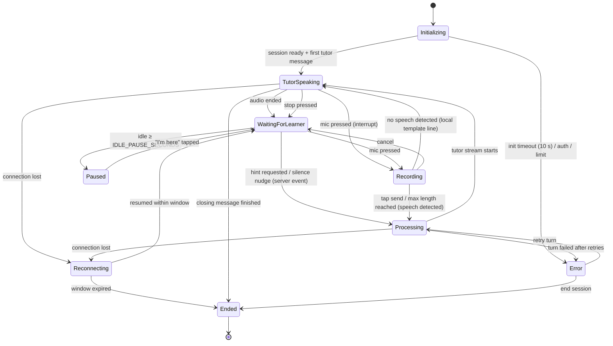
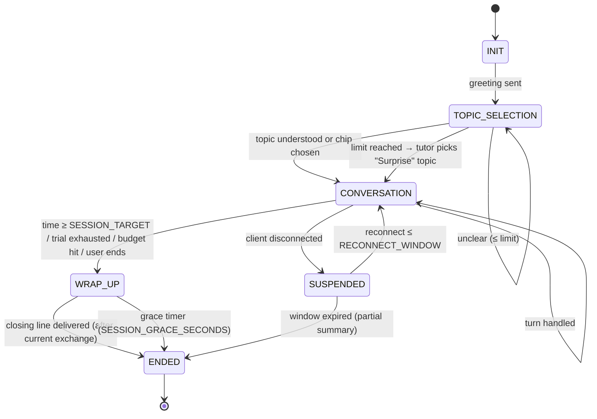
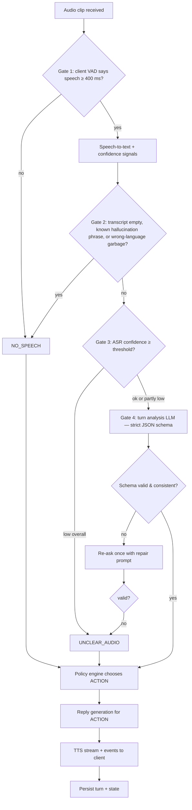

# 07 — Conversation State Machine & Failure Handling

> Related: [06 Tutor behaviour](06-ai-tutor-behavior.md) · [05 Voice & speech architecture](05-voice-and-speech-architecture.md) · [11 API & event contracts](11-api-and-event-contracts.md) · [02 UX §5](02-user-journeys-and-ux.md)

**Principle:** the LLM proposes, deterministic code disposes. Every behaviour that must be reliable — retry counts, hint escalation, timers, limits, when corrections are allowed, when a session ends — is owned by code in this state machine, not by the prompt. The LLM is used for (a) classifying and analysing a learner turn into a strict schema and (b) generating the tutor's natural-language reply *for an action the state machine has already chosen*.

---

## 1. Two cooperating machines

| Machine | Where | Owns | Persistence |
|---|---|---|---|
| **Dialogue machine** | Server (`lib/tutor/dialogue-machine.ts`) | Phase, current tutor prompt, unclear counter, hint level, wrap-up flag, time accounting, correction gating, action selection | Postgres `sessions.state` (JSONB) + `turns` rows, written after every turn → any server instance can continue the session; survives reconnects |
| **Client turn machine** | Browser (XState or a hand-written reducer) | Audio capture/playback, UI states, timers for silence UI, reconnection | In-memory + `sessionStorage` (session id, last acknowledged event seq) |

The client never decides pedagogy; it reports events (`recording_sent`, `hint_requested`, `silence_timeout`, `interrupted`, `card_retry`) and renders what the server returns.

---

## 2. Client turn machine



Client timers (all configurable, defaults from [01 §6](01-product-requirements.md)):

| Timer | Starts | Fires | Action |
|---|---|---|---|
| `SILENCE_HINT_PULSE_SECONDS` (10) | entering WaitingForLearner | 10 s | pulse Hint button (UI only) |
| `SILENCE_NUDGE_SECONDS` (25) | entering WaitingForLearner | 25 s | send `silence_timeout` → server returns a spoken nudge + hint level 1 |
| `IDLE_PAUSE_SECONDS` (90) | after nudge | 90 s total idle | Paused: "Are you still there?" — **active-time clock stops** (D-23) |
| `MAX_RECORDING_SECONDS` (30) | entering Recording | 30 s | auto-send with toast "Sent — keep answers short" (countdown from 25 s) |
| `MIN_SPEECH_MS` (400) | — | — | clips with < 400 ms detected speech are treated as no speech |

---

## 3. Server dialogue machine

### 3.1 Session phases



### 3.2 Per-turn pipeline

For every learner turn the server runs the same pipeline. Gates 1–3 are deterministic; gate 4 is an LLM classification that is then **checked** by deterministic rules.



Gate details, thresholds and confidence signals are specified in [06 §4](06-ai-tutor-behavior.md) and calibrated during Phase 2 (they are **hypotheses until calibrated** on the evaluation set).

### 3.3 Turn categories (output of gates + analysis)

| Category | Meaning | Source |
|---|---|---|
| `NO_SPEECH` | Nothing usable captured (silence, noise, hallucinated phrase) | Gates 1–2 |
| `UNCLEAR_AUDIO` | Speech captured but recogniser not confident enough to trust the words | Gate 3 (or failed analysis) |
| `AMBIGUOUS` | Words recognised confidently but meaning unclear / multiple readings | LLM analysis |
| `UNDERSTOOD` | Meaning clear and responsive to the tutor's prompt (may contain errors) | LLM analysis |
| `UNDERSTOOD_OFF_TOPIC` | Clear meaning but doesn't address the prompt (may be fine — learner steering) | LLM analysis |
| `L1_HELP_REQUEST` | Learner speaks English/L1 to ask how to say something | LLM analysis + language-ID |
| `L1_ANSWER` | Learner answers the question in English/L1 | LLM analysis + language-ID |
| `DONT_KNOW` | "I don't know / わかりません / Keine Ahnung" | LLM analysis |
| `META_REQUEST` | "Repeat please / slower / what does X mean?" | LLM analysis |
| `UNSAFE` | Content the tutor must decline | Moderation + LLM analysis |

### 3.4 Policy engine — action selection

Inputs: category, `unclear_count`, `hint_level`, phase, strictness, `wrap_up` flag, corrections proposed by analysis (each with ASR-risk flag). Output: one `ACTION` plus allowed corrections.

| Category | Condition | Action | State changes |
|---|---|---|---|
| `CONFIRM_HEARD` (recognition plausible but not trustworthy: mean confidence 0.40–0.70) | `unclear_count < UNCLEAR_MAX_RETRIES` | `CONFIRM_HEARD`: show the heard text and ask "Did you say 「…」?" with Yes/No buttons; the LLM is **not** called. **Yes** → the turn continues with the stored transcript (word confidences kept, so corrections on shaky words stay blocked); **No** → treated as `UNCLEAR_AUDIO`; speaking again withdraws the question. The prompt uses up one attempt, so it can never loop. | `unclear_count++` (a prompt is not a learner turn) |
| `NO_SPEECH` / `UNCLEAR_AUDIO` / `AMBIGUOUS` | `unclear_count < UNCLEAR_MAX_RETRIES` | `CLARIFY`: attempt 1 = rephrase request (template; echoes a recovered fragment if any; `AMBIGUOUS` gets an LLM-written confirmation question); attempt 2 (only if `UNCLEAR_MAX_RETRIES` is raised to 2) = **simpler/closed version of the question** — never a plain "please repeat" ([06 §7](06-ai-tutor-behavior.md)) | `unclear_count++` |
| same | `unclear_count == UNCLEAR_MAX_RETRIES` | `SUGGEST_AND_MOVE_ON` — "You can say: …" + continue | `unclear_count = 0`, `hint_level = 0`, flag turn for review |
| `UNDERSTOOD` | — | `RESPOND` (+ ≤1 recast if allowed) + correction cards | reset counters |
| `UNDERSTOOD_OFF_TOPIC` | learner seems to change topic deliberately | `RESPOND` following the learner | reset counters, update topic |
| `UNDERSTOOD_OFF_TOPIC` | response unrelated to question (likely misunderstood the question) | `REPHRASE_QUESTION` (simpler wording) | `unclear_count` unchanged |
| `L1_HELP_REQUEST` | — | `TEACH_PHRASE` (target phrase + invite to say it) | `awaiting_repetition = phrase` |
| `L1_ANSWER` | — | `MODEL_IN_TARGET` ("In Japanese you can say …") + invite | `awaiting_repetition = phrase` |
| `DONT_KNOW` / `silence_timeout` / hint button | `hint_level < 3` | `HINT(level+1)` | `hint_level++` |
| same | `hint_level == 3` | `MODEL_ANSWER_AND_MOVE_ON` | `hint_level = 0` |
| `META_REQUEST` (repeat/slow) | — | `REPLAY` (client-side replay, no LLM) or `EXPLAIN_WORD` | no counter changes |
| `UNSAFE` | — | `DECLINE_AND_REDIRECT` (template + topic chips) | log moderation event |
| any, while `awaiting_repetition` | learner attempt understood | `ACKNOWLEDGE_REPETITION` then continue | clear `awaiting_repetition` |
| any | `wrap_up == true` | the chosen action, then `CLOSE` appended | phase → `ENDED` after delivery |

**Correction gating (deterministic):** corrections come from the asynchronous correction pipeline ([06 §6](06-ai-tutor-behavior.md)), not from the turn call. Summary of the rules the policy engine enforces:

1. If category ≠ `UNDERSTOOD`, no corrections at all.
2. An edit is kept only if ≥ 2 of 3 detection samples agree, no token in its span (±1 neighbour) is an ASR-risk token, ASR-fragile categories pass the stricter τ_fragile check, its taxonomy code is allowed at this level, and it isn't a valid variety/register feature or purely stylistic. **These precision gates are identical at every strictness level.**
3. Strictness only changes *how many and which* surviving edits are shown: Relaxed ≤ 1 card (severity 3) and recasts only for severity-3 recurring errors every other turn; Balanced ≤ 2 cards (severity 2–3), ≤ 1 recast per turn; Strict all gated errors incl. severity 1, plus optional style/variety tips.
4. The spoken recast comes from the turn call's `recast_candidate`, only for `fast_path_recast` categories outside ASR-risk spans; if the full pipeline later rejects it, no card is shown and no error is recorded.

### 3.5 Session-level rules

| Rule | Trigger | Behaviour |
|---|---|---|
| Soft limit | active seconds ≥ `SESSION_TARGET_MINUTES×60` | set `wrap_up`; the next tutor reply answers the learner then closes; no new questions |
| Trial exhausted | user trial remaining ≤ 0 (when `TRIAL_LIMIT_ENABLED`) | same as soft limit; after summary → waitlist |
| Budget kill switch | month-to-date spend ≥ `AI_MONTHLY_BUDGET_USD` | same as soft limit (closing line from template, no LLM call if possible); new sessions refused |
| Grace safeguard | `wrap_up` set and `SESSION_GRACE_SECONDS` elapsed | end immediately with template closing line |
| Turn cap | 40 learner turns in a session | wrap up (abuse/runaway guard) |
| Active time | server measures from session start excluding `SUSPENDED` and client `Paused` intervals | used for limits and stats |

---

## 4. Timeouts, retries and fallbacks per stage

| Stage | Timeout | Retry | Fallback after retries |
|---|---|---|---|
| Upload of audio clip | 10 s | client retries once (same idempotency key) | Reconnecting state; keep clip in memory for resend |
| STT | 8 s | 1 retry; on second failure try fallback STT provider if configured | `PROVIDER_ERROR` turn → template "I had a hiccup, could you say that again?" (does **not** count toward `unclear_count`) |
| Turn analysis LLM | first token 5 s, total 10 s | 1 repair retry for invalid JSON; 1 retry on 5xx/timeout | treat as `UNCLEAR_AUDIO`? **No** — treat as `PROVIDER_ERROR` (the learner did nothing wrong) |
| Reply generation | first token 5 s | 1 retry | template generic continuation for the current topic (pre-written per tutor) |
| TTS | first byte 4 s per sentence | 1 retry per sentence | show text with "Audio unavailable — tap to retry"; avatar does text-only speaking animation |
| Two consecutive `PROVIDER_ERROR` turns | — | — | modal: "Something's wrong on our end. Your conversation is saved." → End & summary / Try again |

Every template line exists per tutor in the target language (with English subtitle), recorded in `tutor_templates` and **pre-synthesised to audio at deploy time** so that recovery speech works even if the LLM is down and costs nothing ([05 §7](05-voice-and-speech-architecture.md)).

---

## 5. Persisted dialogue state (shape)

```ts
type DialogueState = {
  phase: 'INIT' | 'TOPIC_SELECTION' | 'CONVERSATION' | 'WRAP_UP' | 'SUSPENDED' | 'ENDED';
  topic: { id?: string; label: string; source: 'chip' | 'spoken' | 'surprise' } | null;
  goals: { id: string; description: string; achieved: boolean }[];   // 1–2 hidden language goals
  currentPrompt: {                     // what the tutor last asked
    turnId: string;
    text: string;
    expects: 'open' | 'closed' | 'repetition' | 'topic';
    expectedPhrase?: string;           // when expects == 'repetition'
  } | null;
  unclearCount: number;                // resets on any UNDERSTOOD turn
  hintLevel: 0 | 1 | 2 | 3;            // resets when the prompt changes
  consecutiveProviderErrors: number;
  wrapUp: boolean;
  wrapUpReason?: 'time' | 'trial' | 'budget' | 'user' | 'turn_cap';
  activeSeconds: number;
  lastActivityAt: string;              // ISO
  learnerTurnCount: number;
  stateVersion: number;                // optimistic concurrency on every write
};
```

Writes use `UPDATE … WHERE id = $1 AND state->>'stateVersion' = $2` to reject duplicate/concurrent turns (e.g. double-tap send, retried request).

---

## 6. Scenarios

Examples use the Japanese tutor (Yuki) unless noted; English glosses in *italics*. `[…]` = system/UI events.

### Scenario A — Beginner who doesn't know the answer

```
Yuki:  週末は何をしましたか？                      *What did you do at the weekend?*
       [WaitingForLearner; 10 s → Hint pulses]
       [25 s → silence_timeout → HINT(1)]
Yuki:  ゆっくりで大丈夫ですよ。                    *Take your time.*
       [Hint sheet L1: "Say one thing you did. Words: 映画 eiga (movie), 見ました mimashita (watched)"]
Learner: えっと… わかりません。                    *Um… I don't know.*  → DONT_KNOW
       [HINT(2): starter 「週末は ___ をしました。」]
Yuki:  たとえば「週末は…」から始めてみてください。   *Try starting with "At the weekend…"*
Learner: 週末は… 映画を… 見ました。               → UNDERSTOOD (no errors)
Yuki:  いいですね！どんな映画を見ましたか？          *Nice! What kind of movie?*
       [hint_level reset to 0; hint usage recorded = 2]
```

If the learner had stayed stuck after level 2, level 3 gives the full example 「週末は映画を見ました。」 with Play + "Say it"; whether or not they repeat it, the tutor then moves to an easier closed question ("映画は好きですか？" *Do you like movies?*).

### Scenario B — Genuine grammar error

```
Yuki:  昨日は何をしましたか？
Learner: 昨日、友達と公園を行きました。            ASR confidence high on all tokens
       → UNDERSTOOD; analysis error: particle を→に (motion destination), severity: medium, recastable
Yuki:  公園に行ったんですね！楽しかったですか？      *Oh, you went TO the park! Was it fun?* (recast: に)
       [Card — Fix: 公園を行きました → 公園に行きました · "Use に for where you go."  Why ▾ · Try again]
Learner (taps Try again): 友達と公園に行きました。
       [✓ Perfect! — card marked fixed; conversation state unchanged]
```

### Scenario C — Unclear speech

```
Yuki:  好きな食べ物は何ですか？
Learner: [mumbled, street noise] → STT: 「すきな…しく…」 avg confidence low → UNCLEAR_AUDIO
Yuki:  すみません、よく聞こえませんでした。もう一度お願いします。  (template, unclear_count=1)
       [Learner bubble: "(I couldn't catch this)" — "Show what I heard" reveals raw text]
```

No correction, no interpretation, no "Oh, you like sushi!".

### Scenario D — Repeated misunderstanding

```
(continuing C, default UNCLEAR_MAX_RETRIES = 1)
Learner: [still unclear] → limit reached → SUGGEST_AND_MOVE_ON
Yuki:  大丈夫！たとえば「ラーメンが好きです」と言えますよ。じゃあ、私の好きな食べ物を言いますね…
       *No problem! You can say "I like ramen." Let me tell you mine…*
       [Suggested-sentence card with Play + Say it; turn flagged for admin review; counters reset]
```

If `UNCLEAR_MAX_RETRIES` is raised to 2, an extra attempt asks a simpler closed question first (「じゃあ、ラーメンとすし、どちらが好きですか？」 *ramen or sushi?*).

### Scenario E — Valid alternative expression

```
Yuki:  コーヒーと紅茶、どちらが好きですか？           *Coffee or tea — which do you like?*
Learner: コーヒーのほうが好きです。                 expected pattern was 「コーヒーが好きです」
       → UNDERSTOOD; analysis: no errors; alternative_valid=true
Yuki:  「〜のほうが」、上手ですね！私もコーヒー派です。  *Nice use of 〜のほうが! I'm a coffee person too.*
```

No card. If strictness = Strict and the analysis proposes a *style* alternative, it appears as a blue "More natural (optional)" card, never as a Fix.

### Scenario F — Speech-recognition error

```
Yuki:  どこに住んでいますか？
Learner (actually said): プネに住んでいます。
STT: 「プネで住んでいます」  token "で" logprob low (ASR-risk span)
       → UNDERSTOOD; analysis proposes particle で→に correction on the low-confidence span
       → Policy: correction dropped (overlaps ASR-risk span)
Yuki:  プネに住んでいるんですね！プネはどんな町ですか？   (natural echo uses the correct form, but no card, no error logged)
```

The echo models the correct form without claiming an error. If the analysis cannot tell what was meant *because* of the low-confidence span, the category becomes `AMBIGUOUS` → CLARIFY: 「プネに住んでいますか？」 *(Do you live in Pune?)* — a confirmation question, not a correction.

### Scenario G — Network or provider failure

```
Learner taps send → upload succeeds → STT timeout → retry → STT 503
       → PROVIDER_ERROR (unclear_count unchanged)
Yuki:  ごめんなさい、ちょっと聞き取れませんでした。もう一度言ってくれますか？
       (pre-synthesised template; English subtitle "Sorry, I had a hiccup on my side — could you say that again?")
Second consecutive PROVIDER_ERROR → modal "Something's wrong on our end. Your conversation is saved."
       [End & see summary] [Try again]
Client loses network during TutorSpeaking → Reconnecting banner, timer paused
       reconnect ≤ 120 s → client sends last acknowledged event seq → server replays missed events → WaitingForLearner
       reconnect > 120 s → session ENDED with partial summary
```

### Scenario H — Learner asks for repetition or slower speech

```
Learner: もう一度お願いします。 / Can you say that again?  → META_REQUEST(repeat)
       → REPLAY: client replays the cached audio of the last tutor message (no LLM, no TTS cost)
Learner: ゆっくりお願いします。 → META_REQUEST(slow) → client replays at 0.75× (pitch preserved)
```

### Scenario I — Learner uses English for help (code-switching)

```
Yuki:  仕事は何ですか？                              *What's your job?*
Learner: 私は… how do you say "software engineer"?   → L1_HELP_REQUEST
Yuki:  「ソフトウェアエンジニア」です。言ってみてください。  *It's "sofutowea enjinia". Try saying it.*
Learner: 私はソフトウェアエンジニアです。           → ACKNOWLEDGE_REPETITION
Yuki:  完璧です！どんな会社で働いていますか？         *Perfect! What kind of company do you work at?*
       [word saved to "New words"]
```

### Scenario J — Answer unrelated to the question (misunderstood question)

```
Yuki:  何時に起きますか？                            *What time do you get up?*
Learner: はい、好きです。                             *Yes, I like it.*  → UNDERSTOOD_OFF_TOPIC (likely misunderstood)
Yuki:  ええと、朝、何時に起きますか？たとえば、7時？     *Um, in the morning, what time do you wake up? For example, 7?*
       (REPHRASE_QUESTION with a simpler closed alternative; no correction)
```

### Scenario K — Learner interrupts the tutor

Learner presses mic while Yuki is mid-sentence → client stops playback immediately, sends `interrupted{turnId, playedMs}`, starts Recording. The server marks the unplayed remainder of the tutor message as `not_heard` so the next analysis doesn't assume the learner heard it.

### Scenario L — Time / trial / budget limit mid-turn

Limit reached while the learner is recording → the learner's turn is processed normally; `wrap_up` is set → tutor responds to it and then closes: 「今日はたくさん話せましたね。また話しましょう！」 *You talked a lot today. Let's talk again!* → summary → (trial) waitlist.

### Scenario M — Unsafe or inappropriate topic

```
Learner: [explicit / hateful request] → UNSAFE
Yuki:  その話はちょっと…。代わりに、旅行の話はどうですか？  *I'd rather not talk about that. How about travel instead?*
       [topic chips shown]; repeated (3×) → session ends politely; event logged.
```

### Scenario N — Background noise / another speaker

Second voice or TV in the clip often appears as low confidence or wrong-language fragments → handled as `UNCLEAR_AUDIO`; after the 2nd unclear attempt the mic tip "Try a quieter spot or hold the phone closer" appears.

### Scenario O — Learner speaks a long monologue

Recording hits 30 s → auto-send. Analysis is limited to the first ~60 words for corrections (max cards still apply); tutor responds to the main point. Summary notes "Long answer — great fluency practice!" (a positive, not a correction).

### Scenario P — App backgrounded / phone call (mobile)

`visibilitychange → hidden` during TutorSpeaking pauses audio and the active-time clock; on return, the tutor message continues from the start of the current sentence. iOS may suspend the `AudioContext`; the client resumes it on the next user tap (see [05 §8](05-voice-and-speech-architecture.md)).

---

## 7. Implementation notes

- Implement the dialogue machine as a **pure function** `step(state, event, analysis?) → { state, action, corrections }` with exhaustive unit tests (every row in §3.4 is a test case). No I/O inside.
- Implement the client machine with XState v5 (MIT) or a typed reducer; render from machine state only (no ad-hoc booleans).
- Every turn record stores: category, gate outcomes, ASR confidence summary, analysis JSON, chosen action, corrections kept/dropped (with drop reason), latencies, costs. This is what makes the system debuggable and evaluable ([13](13-testing-and-evaluation.md)).
- Feature flag `POLICY_SINGLE_CALL` toggles between the single-call and two-call LLM designs described in [06 §5](06-ai-tutor-behavior.md) so both can be measured in Phase 2.
