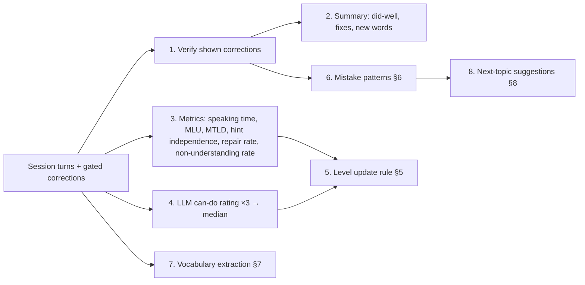

# 08 — Language-Learning Engine

> Related: [06 Tutor behaviour](06-ai-tutor-behavior.md) · [07 State machine](07-conversation-state-machine.md) · [10 Data model](10-database-and-data-model.md) · Evidence: [research/notes/pedagogy-and-reliability.md](research/notes/pedagogy-and-reliability.md)

The learning engine is everything *around* the live conversation that makes it teaching rather than chatting: the learner model, the error taxonomy, the level estimate, recurring-mistake tracking, vocabulary, and how the next session is chosen.

Evidence labels used below: **[E]** = grounded in cited research (see research notes); **[A]** = design assumption to validate in Phase 2/7.

---

## 1. Learner model (per user × target language)

| Component | Stored in | Updated |
|---|---|---|
| Self-assessed level (onboarding answer, never overwritten) | `learner_languages.self_level` | onboarding |
| Per-skill estimate θ (grammar, vocabulary, fluency, comprehension) + uncertainty | `skill_estimates` | end of each qualifying session |
| Error profile (recurring mistakes) | `mistake_patterns` | end of each session |
| Vocabulary seen/used/saved | `vocabulary_items` | during + end of session |
| Independence profile (hint levels, try-again repairs) | derived from `turns` / `corrections` | end of session |
| Preferences (strictness, display, motivations) | `learner_languages` | settings |

The **session level** used to configure the tutor is the displayed level of the weakest of {grammar, comprehension} rounded down — tutors should err on the side of being understood.

---

## 2. Onboarding self-assessment

Self-assessment correlates only moderately with measured proficiency (meta-analytic r ≈ .47 overall, ≈ .44 for speaking; stronger when items describe concrete real-life tasks) **[E]**. Therefore: use concrete can-do items, treat the result as a weak prior, and let the first 2–3 sessions dominate.

**Flow:** the learner first picks the card that sounds most like them ([02 §4.4](02-user-journeys-and-ux.md)); then answers 4 quick "Yes / With help / Not yet" items for that level and the one above. The initial θ per skill = card level + adjustments (each "Yes" on the higher level +0.15, each "Not yet" on the chosen level −0.15), clamped to the card level ±0.5. Initial uncertainty is wide (±0.75).

Can-do statements are **original paraphrases** inspired by the CEFR self-assessment grid and the JF Standard. The CEFR descriptors are Council of Europe copyright; commercial reuse needs permission — do not copy verbatim, credit "based on the CEFR", and get a legal check before commercial launch **[E]** ([17 R-12](17-risks-and-open-decisions.md)).

| Level | Speaking ("In {language}, I can…") | Listening |
|---|---|---|
| A1 | say hello, my name, where I'm from; answer very simple questions about myself if the other person speaks slowly and helps me | understand familiar words when people speak slowly and clearly |
| A2 | talk about my family, work or studies and daily routine in short sentences; handle short everyday exchanges like shopping or directions | understand short, clear everyday phrases and the main point of simple messages |
| B1 | join a conversation on familiar topics without preparing; describe an experience or plan and give a short reason; retell a story or film | follow the main points of clear speech about familiar topics |
| B2 | keep a conversation going on many topics; give and defend an opinion with pros and cons | follow longer talks and discussions on familiar topics |

**Exam certificates are not speaking evidence.** The official JLPT→CEFR reference (on score reports from Dec 2025) covers reception and linguistic competence only, not speaking **[E]**. If a learner mentions "passed N4", use it only as a prior for comprehension/vocabulary.

---

## 3. Error taxonomy

Every correction maps to a taxonomy code. The taxonomy is data (`content/taxonomy/{lang}.yaml`), reviewed by a native-speaker teacher per language before that language launches.

### 3.1 Category schema

```yaml
- code: ja.particle.destination     # unique, language-prefixed
  label: "Particle for destination (に/へ)"
  description: "Use に or へ for where you go, not を."
  severity: { A1: 3, A2: 3, B1: 2, B2: 2 }   # 1 minor · 2 noticeable · 3 meaning-impeding/high-priority
  min_level: A1                       # don't correct below this level
  asr_fragile: true                   # short/unstressed form the recogniser may drop/insert/normalise
  valid_variety: false                # true = never an error (e.g. Indian English features)
  register_sensitive: false           # true = only an error in a specific register
  fast_path_recast: true              # eligible for a spoken recast before full verification (06 §6)
  card_rule: "Use に (or へ) after places you go to."   # ≤ 15 words
  example: { wrong: "公園を行きました", right: "公園に行きました" }
```

### 3.2 Seed categories

Seeded from SLA research and practitioner knowledge **[E]/[A]**; full lists live in the YAML files.

**Japanese (PoC language)**

| Code | Example | Sev (A1/A2/B1/B2) | Min | ASR-fragile | Notes |
|---|---|---|---|---|---|
| `ja.particle.destination` | 公園を行きました → に | 3/3/2/2 | A1 | ✓ | |
| `ja.particle.location_action` | 図書館に勉強します → で | 3/3/2/2 | A1 | ✓ | |
| `ja.particle.object` | 水が飲みます → を | 2/2/2/1 | A1 | ✓ | |
| `ja.particle.wa_ga` | は vs が | –/1/2/2 | A2 | ✓ | Often context-dependent; **only clear cases** (e.g. 〜があります). Strict only below B1. |
| `ja.particle.omission` | 私 学生です | 1/1/1/1 | A2 | ✓ | Legitimate in casual speech; only in polite register |
| `ja.verb.te_form` | かいて/かって | 3/3/2/2 | A1 | ✗ | |
| `ja.verb.tense` | 昨日行きます → 行きました | 3/3/2/2 | A1 | partly | |
| `ja.verb.negative` | | 3/3/2/2 | A1 | partly | |
| `ja.adj.i_past` | おいしいでした → おいしかったです | –/3/2/2 | A2 | ✗ | |
| `ja.adj.na_connection` | 静かの → 静かな | –/2/2/1 | A2 | ✗ | |
| `ja.counter` | りんごが三人 → 三つ | 2/2/2/1 | A1 | ✓ | |
| `ja.register.mixing` | です/ます + plain in one utterance | –/1/2/2 | A2 | ✗ | Style-shifting can be meaningful; flag clear inconsistency only; register-sensitive |
| `ja.vocab.word_choice` | wrong lexical item | 2/2/2/2 | A1 | ✗ | |
| `ja.keigo` | honorific/humble errors | –/–/1/2 | B1 | ✗ | Only in formal scenarios |

Long vowels / っ / ん errors are **pronunciation**, not grammar → never cards in MVP (no pronunciation scoring, highly ASR-fragile).

**German**

| Code | Example | Sev | Min | ASR-fragile | Notes |
|---|---|---|---|---|---|
| `de.wordorder.v2` | Heute ich gehe → Heute gehe ich | 3/3/2/2 | A2 | ✗ | Developmental sequence — don't correct at A1 |
| `de.wordorder.verb_final` | weil ich habe keine Zeit | –/1/2/2 | B1 | ✗ | Colloquial *weil*+V2 exists: severity 1 at B1 |
| `de.verb.separable` | Ich anrufe dich | 2/3/2/2 | A1 | ✗ | |
| `de.verb.perfekt_aux` | Ich habe gegangen → bin | –/3/2/2 | A2 | partly | |
| `de.case.preposition` | mit der Mann → dem | –/2/2/2 | A2 | ✓ | |
| `de.case.verb` | ich helfe dich → dir | –/2/2/2 | A2 | ✓ | |
| `de.gender.article` | die Tisch | 1/2/2/2 | A1 | ✓ | |
| `de.adj.ending` | ein gute Freund | –/–/1/2 | B1 | ✓ | Strict only below B1 |
| `de.register.du_sie` | mixing du/Sie to same person | –/2/2/2 | A2 | ✗ | Tutor uses **du** in free conversation **[A]** |

**English (Indian learners)**

| Code | Example | Sev | Min | ASR-fragile | Notes |
|---|---|---|---|---|---|
| `en.tense.present_perfect_past` | I have gone there yesterday | 2/2/2 (A2/B1/B2) | A2 | partly | |
| `en.question.formation` | Where you are going? | 2/2/1 | A2 | ✗ | |
| `en.agreement.3sg` | He go | 2/2/1 | A2 | ✓ | |
| `en.article` | He is doctor | 1/1/1 | A2 | ✓ | Indian English article use is systematic — Balanced shows only meaning-relevant cases |
| `en.preposition` | discuss about | 1/1/1 | A2 | partly | Some are established Indian English usages |
| `en.vocab.word_choice` | | 2/2/2 | A2 | ✗ | |

### 3.3 Indian English allowlist (mandatory)

Indian English is an established variety; LLMs are documented to default to US/UK norms and to respond worse to non-standard varieties **[E]**. These are **never errors** (`valid_variety: true`). In Strict mode only, they may appear as an optional blue "Tip: in US/UK English people often say…" card:

- Stative verbs in the progressive: "I am having two brothers", "I am knowing him".
- Invariant tag "isn't it?": "You're coming tomorrow, isn't it?"
- Lexical Indianisms: "prepone", "do the needful", "cousin-brother", "out of station", "revert" (= reply).
- "Itself / only" for emphasis: "Today itself", "He is like that only".
- Established prepositional patterns (e.g. "discuss about") → Tip at most.

A future setting "Target style: International / British / American" (post-MVP) can turn more differences into tips — never errors.

---

## 4. End-of-session analysis

Runs once when a session ends (any reason), asynchronously; the summary screen shows a skeleton until it completes (target ≤ 6 s).



1. **Verify** — a second, independent pass re-checks each *shown* correction against the transcript (different prompt; the cheaper model can be used). Disagreement marks `verified=false`: the card stays in history but is excluded from recurring-mistake counts and the level update, and the summary shows it under "Worth a second look" instead of "Fixes". Note: self-verification by the same model is not reliable on its own **[E]**, so the verifier uses a different prompt and must cite the taxonomy rule; it can only *remove*, never add, corrections.
2. **Summary** — structured JSON: `didWell[1–3]` (specific, evidence-based: "You used 〜のほうが correctly"), `fixes[]` (verified cards grouped by category), `newWords[]`, `nextFocus` (one category).
3. **Metrics** — computed deterministically from turns (see §5 table).
4. **Can-do rating** — LLM rates the transcript against the can-do descriptors for the session level and adjacent levels; **3 samples, median**, pinned model version, temperature fixed. Weighted modestly (it's noisy and L1-dependent **[E]**).
5–8 — below.

---

## 5. Level estimate

### 5.1 What we can measure, and how much we trust it

| Signal | Skill(s) | Reliability per 5-min session |
|---|---|---|
| Learner speaking time, turns, mean length of utterance (words; morphemes for Japanese via the tokenizer used for furigana) | fluency | Good (compare within learner only) |
| Speech-internal pauses / speech rate (from STT word timings if available) | fluency | Moderate |
| Hint level per turn, "You can say" uses, L1 help requests | all (independence) | Good |
| Try-again repair success | grammar | Good |
| Comprehension: unrelated answers (`UNDERSTOOD_OFF_TOPIC` misunderstanding cases), META "repeat/what does X mean" requests, translation taps | comprehension | Moderate |
| Lexical diversity (MTLD, aggregated across sessions) | vocabulary | Weak per session, OK aggregated |
| Gated error rate per 100 words | grammar | Weak — a **lower bound** (ASR masks errors) |
| LLM can-do rating (median of 3) | all | Noisy |

### 5.2 Update rule **[A]** (Elo-family rationale **[E]**)

Each skill *s* has a continuous score θₛ on a 0–6 scale (A1 = 1 … C2 = 6; the band for A2 is [2, 3)).

```
x_s   = Σ w_i · normalise_i(signal_i)      // per-session evidence mapped to the same 0–6 scale
k_n   = max(0.15, 1 / (n + 1.5))           // n = qualifying sessions so far → big moves early, small later
Δ     = clamp(k_n · (x_s − θ_s), −0.5, +0.5)
θ_s  ← θ_s + Δ
uncertainty_s = stdev(last 5 x_s), min 0.15
```

- **Qualifying session:** ≥ 60 s of learner speech and non-understanding rate ≤ 30% (bad-audio sessions don't move the estimate).
- **Displayed level hysteresis:** the displayed level changes only after θₛ has been ≥ 0.2 beyond the band boundary for **2 consecutive** qualifying sessions.
- **Weights** start equal across available signals for a skill and are tuned in Phase 7 against human ratings of a sample of sessions.
- Every update writes `level_estimate_history` with the evidence (debuggable, explainable).

### 5.3 Display

"Estimated level **A2** · likely A2–B1 · based on your last 5 sessions" + per-skill bars labelled *estimate*, and a tooltip: "We estimate from how you speak in sessions. It's not an exam result." Never show raw error rates as grades. Show progress signals instead ("You needed fewer hints than last week").

---

## 6. Recurring mistakes

At session end, for each verified shown correction: upsert `mistake_patterns(learner_language, error_code)` — increment `occurrences`, update `sessions_n`, `last_seen`, keep last 3 examples.

From the analysis JSON, also count **correct uses** of each tracked category's structure in the session (the analysis lists structures the learner used correctly, e.g. `ja.particle.destination: 2`).

| Status | Rule |
|---|---|
| `active` | `sessions_n ≥ 2` (this is what "recurring" means in the UI) |
| `improving` | ≥ 2 correct uses since the last error |
| `resolved` | not seen in the last 3 sessions **and** ≥ 3 correct uses since the last error |

`resolved` patterns produce a green "Nice!" card the next time the learner uses the structure correctly (FR-40).

Feeding back into conversations: the top active pattern (by severity × recency) becomes one of the session's hidden goals when the learner picks a related topic or "Surprise me" (§8), and is preferred for the spoken recast when it occurs.

---

## 7. Vocabulary

- **New words** — words the tutor introduced (taught phrases, hint keywords, words in "You can say", L1 help answers) and words in verified corrections. Stored with lemma, reading (Japanese), meaning (English; Hindi on the English track), example.
- **Used words** — lemmas the learner produced correctly (from analysis) increment `times_used`.
- **Saved words** — explicit learner action (long-press/word popover or summary "Save").
- **Introduction rate** **[A]**: tutor aims for ≤ 3 new words per 5-minute session at A1–A2, ≤ 5 at B1–B2, and reuses words from the learner's recent new/saved list when natural (implicit review).
- Spaced repetition (post-MVP): convert saved words and verified corrections into review items scheduled with **ts-fsrs** (MIT) at ~0.9 desired retention; spoken review counts as a grade **[E]**.

---

## 8. Topics, goals and next-session suggestions

### 8.1 Content: topic & goal library (curated data)

`content/topics/{lang}.yaml` — for MVP ≈ 30 topics per language spanning A1–B2, each with level range, motivation tags, suggested goals and setting (for background art):

```yaml
- id: food-ordering
  label: "Ordering food"
  levels: [A1, A2, B1]
  motivations: [travel, culture, fun]
  setting: cafe
  goals:
    A1: ["ja.goal.kudasai", "ja.goal.like_dislike"]
    A2: ["ja.goal.recommendation_ask", "ja.particle.object"]
    B1: ["ja.goal.preferences_reason"]
```

Goals are either **functions** ("ask for a recommendation") or **structures** (a taxonomy code). The tutor sees goals as private guidance ([06 §3](06-ai-tutor-behavior.md)); the objective chip shows the function in learner-friendly words.

### 8.2 Spoken topic (D-13)

When the learner names their own topic, the analysis maps it to the nearest library topic (for goals/background) or creates an ad-hoc topic with generic level goals. Unsafe topics → decline and offer chips.

### 8.3 Suggestion algorithm (dashboard and session start)

Score each eligible topic (level in range):

```
score = 0.4·motivation_match + 0.3·weak_spot_match + 0.2·novelty + 0.1·random
```

- `weak_spot_match` = 1 if the topic's goals include the top active mistake pattern.
- `novelty` = 1 − (times practised in last 14 days / 3, clamped).
- Show the top 3 + "Surprise me" (weighted random from the top 8). One chip is labelled with its weak spot ("Fix: particles").

---

## 9. In-session level adaptation

Configured per session from the session level (§1); enforced partly by prompt, partly by code:

| Level | Tutor turn (target language) | Question style | Speech | Script & support |
|---|---|---|---|---|
| A1 | 1–2 short sentences, ≤ 12 words, high-frequency words | yes/no, either/or, "What's your…?" with a model answer one tap away | TTS speed 0.85–0.9 **[A]** | JA: kana + romaji on; translation shown by default |
| A2 | ≤ 2 sentences, ≤ 20 words | simple wh-questions on routine topics | 0.9–0.95 | JA: kanji + furigana |
| B1 | ≤ 3 sentences | open "why / how / tell me about" | 1.0 | furigana optional |
| B2 | ≤ 3–4 sentences | opinions, pros/cons, hypotheticals | 1.0 | furigana off by default |

Universal rules (all levels) **[E]/[A]**: each tutor turn ends with exactly **one** question or invitation; the tutor never answers its own question; recast first (if any) → brief content response → question. Prefer referential (genuine-information) questions from A2 — they elicit longer, more complex answers than display questions **[E]**.

Code-enforced checks on each generated reply: word/character count ≤ level budget × 1.3 (else regenerate once, then truncate at the last sentence boundary before the question is lost → use a template question); exactly one question mark (`？`/`?`) at the end (else regenerate once).

**Simplify mode** (automatic): if non-understandings exceed 15% of the last 10 turns, or 2 consecutive `UNDERSTOOD_OFF_TOPIC` misunderstanding cases occur, the session level drops one band for tutor output, speech slows one step, and pre-emptive "You can say" chips appear **[E]** (Bohus & Rudnicky 2005 propose pre-emptive "you can say" for non-native users). Exits after 4 consecutive understood turns.

**Talk-ratio target** **[A]**: learner share of speaking time ≥ 40% (A1), ≥ 50% (A2+). Tracked per session; persistent shortfall alerts in admin (prompt tuning signal).

---

## 10. Register & cultural defaults

| Language | Default | Switching |
|---|---|---|
| Japanese | Tutor speaks です/ます (polite) at all levels by default | Casual (plain) forms from B1 or in friend-chat topics, announced explicitly ("Let's talk casually now!"). Plain form in a casual topic is never an error. Keigo corrections only at B1+ in formal topics (interview, business). |
| German | Tutor uses **du** (friendly peer persona) — owner decision D-50 | **Sie** in service/work/formal topics; only *inconsistency* toward the same addressee, or du in a clearly formal topic, is flagged (Balanced+). |
| English | "Clear international English"; Indian English features valid (§3.3) | — |

---

## 11. Pronunciation (not in MVP)

The MVP gives no pronunciation feedback beyond "I didn't catch that" (D-17); LLM-generated pronunciation scores are rejected as unreliable. Post-MVP candidates (specialised pronunciation-assessment services) are compared in [04](04-ai-provider-research.md); any future scores must be validated against native-rater judgements on Indian-L1 learner audio before being shown.
