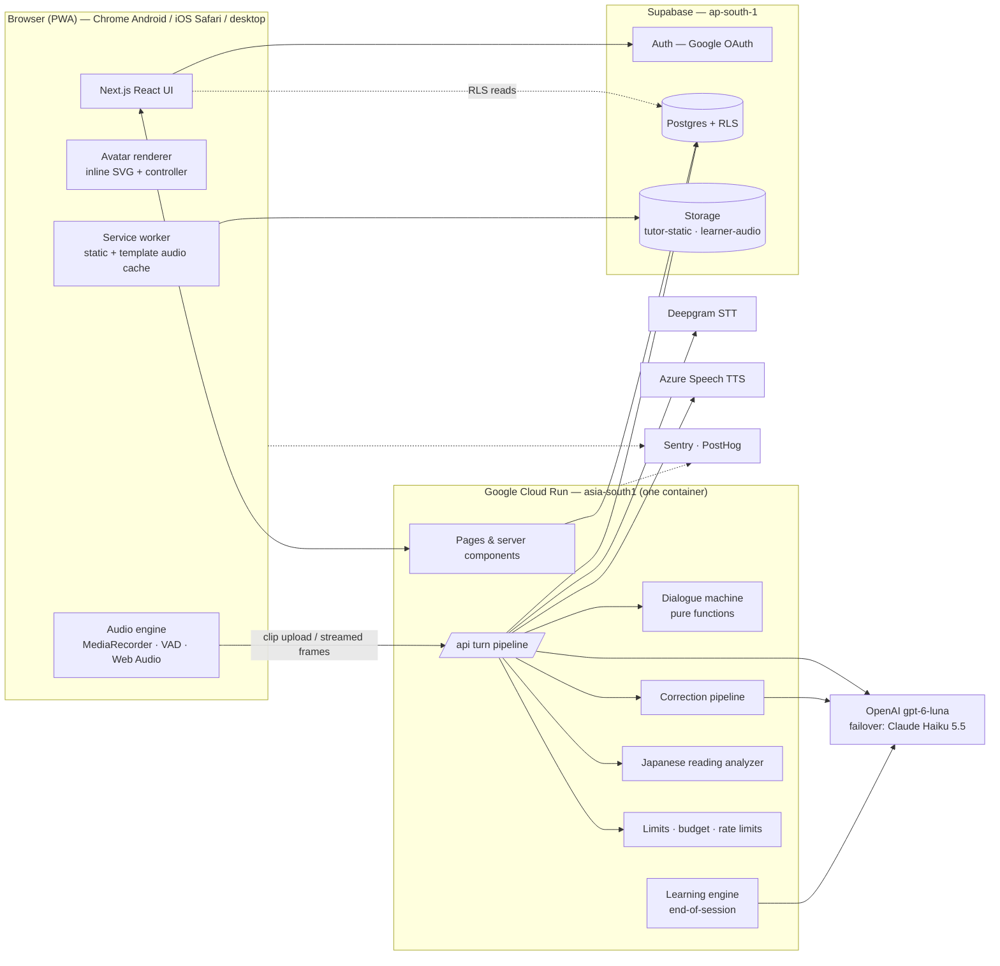

# 09 — System Architecture

> Related: [05 Voice & speech](05-voice-and-speech-architecture.md) · [07 State machine](07-conversation-state-machine.md) · [10 Data model](10-database-and-data-model.md) · [11 API & events](11-api-and-event-contracts.md) · [14 Security & privacy](14-security-and-privacy.md) · [15 Deployment](15-deployment-and-operations.md)

**Shape:** one Next.js (App Router, TypeScript) application in one container on Cloud Run (Mumbai), talking to Supabase (Mumbai) and three AI providers. No microservices, no queues, no Redis. Everything a solo developer must operate fits in one repo, one container, one database.

---

## 1. Context diagram



---

## 2. Responsibilities

| Layer | Owns | Must not |
|---|---|---|
| **Frontend** | Rendering, client turn machine, mic capture + VAD, audio playback + lip-sync scheduling, UI timers (hint pulse, nudge trigger), local caches, accessibility | Decide pedagogy, count limits, judge correctness, hold provider keys |
| **Backend (route handlers / server actions)** | Auth checks, limits & budget, the turn pipeline, the dialogue machine, gating, correction pipeline, persistence, end-of-session analysis, admin | Trust client-reported time, categories or costs |
| **AI services** | Transcription, classification + reply generation (strict JSON), edit candidates, explanations, summaries, speech synthesis | Decide retries, limits, which corrections are shown, what's stored |
| **Deterministic logic** | State transitions, retries, hint escalation, correction gates, strictness caps, level update math, active-time accounting, budget kill switch | — |

---

## 3. Repository layout

```
/app
  /(marketing)/page.tsx                 landing
  /(auth)/signin, /auth/callback/route.ts
  /onboarding/[step]/page.tsx
  /home, /review, /history, /settings, /waitlist, /admin
  /practice/[sessionId]/page.tsx        conversation screen (client component tree)
  /practice/[sessionId]/summary/page.tsx
  /api/sessions/route.ts                POST create session
  /api/sessions/[id]/turns/route.ts     POST learner turn → streamed frames
  /api/sessions/[id]/events/route.ts    POST client events (hint, silence, interrupt, card retry)
  /api/sessions/[id]/end/route.ts
  /api/sessions/[id]/resume/route.ts
  /api/account/route.ts                 DELETE account, GET export
  /dev/avatar/page.tsx                  Avatar Lab (dev only)
/lib
  /tutor/dialogue-machine.ts            pure step() — 07
  /tutor/policy.ts                      action selection + correction gates — 06 §6, 07 §3.4
  /tutor/prompts/                       prompt builders (versioned)
  /tutor/schemas.ts                     Zod + JSON schemas (turn, edits, explain, summary)
  /tutor/correction-pipeline.ts
  /learning/level-estimate.ts           08 §5
  /learning/mistakes.ts, vocabulary.ts, topics.ts
  /providers/stt/{deepgram,scribe,azure}.ts      SttProvider
  /providers/llm/{openai,anthropic}.ts           LlmProvider
  /providers/tts/{azure,elevenlabs}.ts           TtsProvider (+ viseme mapping)
  /japanese/readings.ts                 kuroshiro singleton + overrides
  /limits/{budget,trial,rate-limit}.ts
  /db/                                  typed queries (supabase-js / postgres.js)
  /telemetry/                           structured logs, cost accounting
/components
  /avatar/{AvatarStage,svg-renderer,controller}.ts(x)
  /audio/{recorder,vad,player,frames}.ts
  /conversation/*                       transcript, correction cards, hint sheet, controls
  /ui/*                                 design-system primitives
/content
  /tutors/*.ts  /templates/*.yaml  /topics/*.yaml  /taxonomy/*.yaml  /prompts/*.md
/assets/avatars/src/*.svg
/eval                                   datasets, runners, reports — 13
/supabase/migrations/*.sql
/scripts                                avatars:build, audio:build, eval:*
```

---

## 4. Frontend architecture

- **Next.js App Router**, React Server Components for data-heavy pages (dashboard, history), a single client component tree for `/practice/[id]`.
- **State:** client turn machine (XState v5 or typed reducer) is the single source of truth on the conversation screen; TanStack Query for server data elsewhere.
- **Audio engine** (`/components/audio`): `Recorder` (MediaRecorder + format detection), `EnergyVad`, `FrameReader` (parses the streamed response), `Player` (AudioContext scheduling, interrupt, replay, slow via `<audio>`).
- **Avatar** (`/components/avatar`): `AvatarRenderer` interface ([03 §B1](03-design-system-and-avatar-spec.md)); SVG inlined server-side for the active tutor.
- **Styling:** Tailwind v4 + CSS variables from the design system; Radix primitives for accessible overlays.
- **PWA:** manifest + service worker (Serwist/Workbox) precaching shell, avatars, fonts for the current language, template audio. Offline page.
- **Analytics:** PostHog (trimmed ~10 events/session), only after consent; Sentry for errors (no audio, no transcripts in breadcrumbs).

## 5. Backend architecture

- Runs as Node.js route handlers in the same Next.js server (no Edge runtime — Japanese analyzer and Azure Speech SDK need Node).
- **Turn handler** (the hot path) — pseudocode:

```ts
export async function POST(req, { params }) {
  const user = await requireUser(req);                           // Supabase JWT
  const session = await loadSessionForUpdate(params.id, user.id);
  await assertLimits({ user, session });                         // trial, budget kill switch, rate limits
  const { audio, meta } = await parseMultipart(req);             // ≤ 2 MB
  const stream = createFrameStream();                            // length-prefixed frames → Response
  (async () => {
    const t = startTrace(session, meta.turnSeq);
    const asr = await stt.transcribe(audio, langsFor(session));   // timeout 8 s, 1 retry
    stream.event('transcript', publicTranscript(asr));
    const gate = applyGates(asr, session);                        // G2–G4 (06 §4.1)
    let action, reply;
    if (gate.category) {
      ({ action } = step(session.state, { type: 'learner_turn', category: gate.category }));
    } else {
      const llm = tutorTurnStream(buildPrompt(session, asr));     // strict JSON, streamed
      const analysis = await llm.analysis();                      // first ~40 tokens
      ({ action } = step(session.state, { type: 'learner_turn', analysis, asr }));
      if (usesLlmReply(action)) reply = llm.reply(); else llm.abort();
      if (analysis.category === 'understood') runCorrectionPipeline(session, asr, analysis, stream); // async
    }
    for await (const sentence of sentencesFor(action, reply, session)) {   // template or LLM
      const ruby = isJa(session) ? readings(sentence.text) : null;
      const { mp3, visemes } = await tts.synthesize(toSsml(sentence, ruby, session.tutor.voice));
      stream.event('sentence', { ...sentence, ruby, visemes });
      stream.audio(mp3);
    }
    await persistTurn(session, { asr, gate, action, reply, trace: t.end() });   // optimistic concurrency
    await recordUsage(t.costs);                                   // ledger + monthly_spend
    stream.event('turn_end', { state: publicState(session) });
    stream.close();
  })().catch(err => stream.fail(err));
  return new Response(stream.readable, { headers: { 'Content-Type': 'application/octet-stream', 'Cache-Control': 'no-store', 'X-Accel-Buffering': 'no' } });
}
```

- **Long-running work** (end-of-session analysis, erasure jobs, audio purge) runs in-request or via **Cloud Scheduler → HTTP endpoint** (free tier: 3 jobs) — no queue infrastructure.
- **Japanese analyzer and Azure SDK** are module-level singletons, warmed on container start.

## 6. Authentication & authorisation

- Supabase Auth with **Google OAuth** (PKCE via `@supabase/ssr`), callback route exchanges the code; only relative `next` redirects.
- Every API route calls `requireUser()`; sessions are loaded with `user_id = auth user` checks; RLS protects client-side reads.
- **Admin:** `ADMIN_EMAILS` allow-list checked server-side on `/admin` and admin APIs.
- **Age gate & consent** enforced server-side: no session creation until `adult_confirmed_at` and `privacy_accepted_at` are set ([14](14-security-and-privacy.md)).

## 7. Conversation session management

- `POST /api/sessions` creates the session (snapshotting tutor/prompt/provider versions), returns the greeting (template audio + topic chips).
- State lives in `sessions.state` (JSONB) with `stateVersion` optimistic concurrency → any Cloud Run instance can serve any turn; no sticky sessions.
- Turn requests carry `turnSeq` + idempotency key; duplicates return the stored result.
- **Resume:** client keeps `sessionId` + last acknowledged frame seq in `sessionStorage`; `/resume` returns missed events (re-synthesising audio only if needed) within `RECONNECT_WINDOW_SECONDS`.
- **Active time** is computed server-side from turn timestamps and client `pause/resume` events, capped per interval ([07 §3.5](07-conversation-state-machine.md)).

## 8. Limits, budget & usage

| Control | Where | How |
|---|---|---|
| Trial | `limits/trial.ts` | `TRIAL_LIMIT_ENABLED`, `TRIAL_LIMIT_MINUTES`; `profiles.trial_seconds_used` updated atomically per turn; exhaustion sets `wrapUp` |
| Budget kill switch | `limits/budget.ts` | Each provider call's cost computed from a versioned price table → `usage_ledger` + `monthly_spend` in one transaction; check before every paid call; ≥ 100% → no new sessions, active sessions wrap up with template lines |
| Early warning | admin + email | 50%, 80%, 100% thresholds |
| Cloud-level cap | GCP | Cloud Run spend-cap budget (~$25) + alert budgets; OpenAI project monthly limit; Azure budget alert; Deepgram credit monitoring |
| Rate limits | `limits/rate-limit.ts` | Postgres fixed-window counters: turns ≤ 20/min/user, ≤ 60/min/IP-hash; session creates ≤ 10/hour/user; new trial accounts ≤ `TRIAL_ACCOUNTS_PER_IP_PER_DAY`; per-instance token bucket for bursts |
| Payload limits | turn route | audio ≤ 2 MB, ≤ 30 s; reject other content types |

## 9. Analytics & event tracking (PostHog, consent-gated)

Product events (~10 per session): `onboarding_completed`, `session_started {lang, level, topic_source}`, `turn_completed {category, action, latency_ms}` (sampled), `hint_used {level}`, `correction_shown {code, card}`, `correction_reported`, `try_again {success}`, `session_ended {reason, active_s}`, `trial_exhausted`, `waitlist_joined {price}`. No transcripts or audio in analytics. Session replay: off by default; when enabled, masks all text.

## 10. Logging & observability

- **Structured JSON logs** (Cloud Logging) per turn: session id, turn seq, category, action, per-stage latency, provider/model, cost, kept/dropped correction counts, error codes. **No transcript text in logs.**
- **Traces:** a lightweight span per stage (OpenTelemetry → Sentry performance, 5M spans free).
- **Dashboards** (admin page, SQL over `turns`/`usage_ledger`): p50/p90 latency per stage, unclear rate, provider error rate, cost per session, correction report rate per category.
- **Alerts:** provider error rate > 5% over 15 min, p90 latency > 5 s, budget 80%, Sentry new-issue emails.

## 11. Security & privacy (summary — full in [14](14-security-and-privacy.md))

Provider keys only in Secret Manager → env; service-role key server-only; RLS on all tables; CSP; no learner audio persisted without opt-in; transcripts never sent to analytics; processors under DPAs; DPDP notice/consent/rights flows.

## 12. Deployment & CI/CD (summary — full in [15](15-deployment-and-operations.md))

GitHub Actions: lint → typecheck → unit tests (dialogue machine, policy, level math) → build → avatar validation → container build → deploy to Cloud Run (staging → prod on tag). Nightly: eval regression subset + voice regression. Supabase migrations applied via CLI in the pipeline.

## 13. Scaling path (only when needed)

| Trigger | Change |
|---|---|
| Cloud Run compute > $20/month | Move `/api/.../turns` to instance-based billing, or to a CPU-billed runtime (Workers) — the turn handler is isolated behind `lib/` interfaces |
| DB > 400 MB (Free) or public launch | Supabase Pro |
| > 10k MAU | Archive old turns to compressed JSON; consider read replicas only if dashboards slow down |
| Hands-free mode demanded | Evaluate realtime speech-to-speech for that mode only ([17](17-risks-and-open-decisions.md)) |
