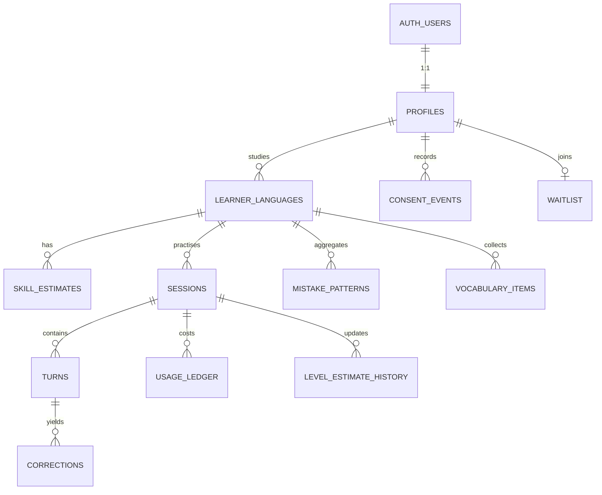

# 10 — Database & Data Model

> Related: [09 System architecture](09-system-architecture.md) · [07 State machine §5](07-conversation-state-machine.md) · [08 Learning engine](08-language-learning-engine.md) · [14 Security & privacy](14-security-and-privacy.md)

Database: **Supabase Postgres**. Auth: **Supabase Auth (Google)** — `auth.users` is owned by Supabase; our tables reference it. Migrations live in `supabase/migrations/*.sql` and are applied with the Supabase CLI.

Design rules:

- **Server-side writes only.** The browser reads its own data through RLS-protected selects (dashboard, history), but every write happens in Next.js route handlers / server actions using the service role, after validation. This keeps business rules (limits, gating) out of the client.
- **Snapshot configuration into sessions.** Tutor persona, voice settings, model ids and prompt versions are code-versioned; each session stores the versions it ran with so behaviour is reproducible and evaluable.
- **Append-only usage ledger** for cost tracking and the kill switch.
- **Privacy by default:** no audio paths unless opted in; IPs stored only as salted hashes.

---

## 1. Entity-relationship overview



---

## 2. Tables

### 2.1 Enums

```sql
create type target_lang as enum ('ja', 'de', 'en');
create type cefr_level as enum ('A1', 'A2', 'B1', 'B2');
create type strictness as enum ('relaxed', 'balanced', 'strict');
create type skill as enum ('grammar', 'vocabulary', 'fluency', 'comprehension');
create type session_status as enum ('active', 'suspended', 'ended');
create type end_reason as enum ('time', 'trial', 'budget', 'user', 'turn_cap', 'grace', 'disconnect', 'error', 'unsafe');
create type turn_role as enum ('tutor', 'learner', 'system');
create type turn_category as enum (
  'NO_SPEECH','UNCLEAR_AUDIO','AMBIGUOUS','UNDERSTOOD','UNDERSTOOD_OFF_TOPIC',
  'L1_HELP_REQUEST','L1_ANSWER','DONT_KNOW','META_REQUEST','UNSAFE','PROVIDER_ERROR');
create type card_type as enum ('fix', 'alternative', 'praise');
create type correction_status as enum ('shown', 'dropped');
create type correction_report as enum ('was_correct', 'misheard', 'other');
create type usage_kind as enum ('stt', 'llm', 'tts', 'moderation');
```

### 2.2 `profiles`

```sql
create table profiles (
  id                  uuid primary key references auth.users(id) on delete cascade,
  display_name        text not null,
  email               text not null,
  adult_confirmed_at  timestamptz,                 -- 18+ confirmation (required before use)
  privacy_notice_ver  text,                        -- version accepted
  privacy_accepted_at timestamptz,
  audio_opt_in        boolean not null default false,
  audio_opt_in_at     timestamptz,
  trial_seconds_used  integer not null default 0,  -- one-time trial (D-31); server-maintained
  active_language_id  uuid,                        -- fk set after onboarding
  prefs               jsonb not null default '{}', -- sound, reduced motion, etc.
  created_at          timestamptz not null default now(),
  deleted_at          timestamptz                  -- soft-delete marker during erasure job
);
```

### 2.3 `learner_languages`

One row per (user, target language). Holds the per-language learner profile.

```sql
create table learner_languages (
  id              uuid primary key default gen_random_uuid(),
  user_id         uuid not null references profiles(id) on delete cascade,
  target          target_lang not null,
  native_lang     text not null,                   -- BCP-47, e.g. 'hi', 'ta', 'en'
  self_level      cefr_level not null,             -- onboarding answer (never overwritten)
  motivations     text[] not null default '{}',
  strictness      strictness not null default 'balanced',
  display         jsonb not null default '{}',     -- { furigana: true, romaji: false }
  onboarding_done boolean not null default false,
  created_at      timestamptz not null default now(),
  unique (user_id, target),
  constraint en_min_a2 check (target <> 'en' or self_level <> 'A1')   -- D-22
);
```

### 2.4 `skill_estimates` and `level_estimate_history`

```sql
create table skill_estimates (
  learner_language_id uuid not null references learner_languages(id) on delete cascade,
  skill        skill not null,
  score        real not null,          -- continuous scale, see 08 §5 (A1=1.0 … B2=4.99)
  uncertainty  real not null,          -- shrinks as evidence accumulates
  level        cefr_level not null,    -- displayed level after hysteresis
  sessions_n   integer not null default 0,
  updated_at   timestamptz not null default now(),
  primary key (learner_language_id, skill)
);

create table level_estimate_history (
  id                  bigint generated always as identity primary key,
  learner_language_id uuid not null references learner_languages(id) on delete cascade,
  session_id          uuid references sessions(id) on delete set null,
  skill               skill not null,
  score_before        real not null,
  score_after         real not null,
  evidence            jsonb not null,  -- metrics used (see 08 §5)
  created_at          timestamptz not null default now()
);
```

### 2.5 `sessions`

```sql
create table sessions (
  id                  uuid primary key default gen_random_uuid(),
  user_id             uuid not null references profiles(id) on delete cascade,
  learner_language_id uuid not null references learner_languages(id) on delete cascade,
  tutor_id            text not null,          -- 'yuki-ja'
  config_versions     jsonb not null,         -- { tutor: 'yuki@3', prompt: 'turn@7', stt: '…', llm: '…', tts: '…', voice: '…' }
  level_at_start      cefr_level not null,
  topic               jsonb,                  -- { label, source, chipId }
  goals               jsonb not null default '[]',
  state               jsonb not null,         -- DialogueState (07 §5), includes stateVersion
  status              session_status not null default 'active',
  end_reason          end_reason,
  started_at          timestamptz not null default now(),
  last_activity_at    timestamptz not null default now(),
  ended_at            timestamptz,
  active_seconds      integer not null default 0,
  learner_speech_ms   integer not null default 0,
  learner_turns       integer not null default 0,
  hints_used          integer not null default 0,
  cost_usd            numeric(10,5) not null default 0,
  summary             jsonb,                  -- end-of-session analysis output (08 §4)
  flagged             boolean not null default false,
  flag_reasons        text[] not null default '{}'
);
create index on sessions (user_id, started_at desc);
create index on sessions (flagged) where flagged;
create index on sessions (status) where status <> 'ended';
```

### 2.6 `turns`

```sql
create table turns (
  id                uuid primary key default gen_random_uuid(),
  session_id        uuid not null references sessions(id) on delete cascade,
  seq               integer not null,                -- monotonic per session
  role              turn_role not null,
  -- learner turns
  category          turn_category,
  transcript        text,
  asr               jsonb,      -- { provider, model, language, meanLogprob, lowConfSpans:[{start,end,text}], durationMs, speechMs }
  analysis          jsonb,      -- validated LLM analysis JSON (06 §5)
  action            text,       -- policy action chosen (07 §3.4)
  -- tutor turns
  text              text,       -- tutor text (target language)
  segments          jsonb,      -- [{ i, text, ruby?, translation?, audioKey, durationMs, notHeard? }]
  template_id       text,       -- if a pre-written template was used
  -- both
  latency           jsonb,      -- { uploadMs, sttMs, llmTtftMs, llmTotalMs, ttsTtfbMs, firstAudioMs }
  audio_path        text,       -- only if user opted in; storage object path
  audio_expires_at  timestamptz,
  idempotency_key   text,
  created_at        timestamptz not null default now(),
  unique (session_id, seq),
  unique (session_id, idempotency_key)
);
```

### 2.7 `corrections`

Every correction the analysis proposed is stored — including dropped ones with the reason — because dropped corrections are core evaluation data for the false-correction metric.

```sql
create table corrections (
  id                  uuid primary key default gen_random_uuid(),
  turn_id             uuid not null references turns(id) on delete cascade,
  session_id          uuid not null references sessions(id) on delete cascade,
  learner_language_id uuid not null references learner_languages(id) on delete cascade,
  error_code          text not null,     -- taxonomy code, e.g. 'ja.particle.ni_wo' (08 §3)
  severity            smallint not null, -- 1 minor … 3 meaning-changing
  card                card_type not null,
  original            text not null,
  corrected           text not null,
  explanation         text not null,
  spoken_recast       boolean not null default false,
  status              correction_status not null,
  drop_reason         text,              -- 'asr_risk' | 'strictness' | 'cap' | 'category' | 'verifier'
  try_again_attempts  smallint not null default 0,
  fixed_on_retry      boolean,
  verified            boolean,           -- end-of-session verifier agreed (08 §4)
  user_report         correction_report,
  user_report_note    text,
  created_at          timestamptz not null default now()
);
create index on corrections (learner_language_id, error_code);
```

### 2.8 `mistake_patterns` (recurring mistakes)

Aggregated at session end from `corrections` where `status='shown'` and `verified is not false` and `user_report is null`.

```sql
create table mistake_patterns (
  learner_language_id uuid not null references learner_languages(id) on delete cascade,
  error_code     text not null,
  occurrences    integer not null,
  sessions_n     integer not null,          -- distinct sessions with this error
  correct_uses_n integer not null default 0,-- times used correctly since last error (from analysis)
  first_seen     timestamptz not null,
  last_seen      timestamptz not null,
  examples       jsonb not null,            -- last 3 { original, corrected, sessionId }
  status         text not null default 'active',  -- 'active' | 'improving' | 'resolved'
  primary key (learner_language_id, error_code)
);
```

"Recurring" = `sessions_n ≥ 2`. Status rules in [08 §6](08-language-learning-engine.md).

### 2.9 `vocabulary_items`

```sql
create table vocabulary_items (
  id                  uuid primary key default gen_random_uuid(),
  learner_language_id uuid not null references learner_languages(id) on delete cascade,
  lemma               text not null,     -- dictionary form
  surface             text,              -- form as seen
  reading             text,              -- kana reading (ja)
  meaning             text not null,     -- English (or Hindi for en track)
  example             text,
  source_session_id   uuid references sessions(id) on delete set null,
  saved               boolean not null default false,  -- learner explicitly saved
  times_seen          integer not null default 1,
  times_used          integer not null default 0,      -- learner produced it correctly
  created_at          timestamptz not null default now(),
  unique (learner_language_id, lemma)
);
```

### 2.10 Cost, limits and abuse

```sql
create table usage_ledger (
  id          bigint generated always as identity primary key,
  user_id     uuid references profiles(id) on delete set null,  -- keep cost history after erasure
  session_id  uuid references sessions(id) on delete set null,
  turn_id     uuid,
  kind        usage_kind not null,
  provider    text not null,
  model       text not null,
  units       numeric not null,
  unit_type   text not null,            -- 'audio_seconds' | 'input_tokens' | 'cached_input_tokens' | 'output_tokens' | 'characters'
  cost_usd    numeric(10,6) not null,   -- computed from price table in code (versioned)
  price_ver   text not null,
  created_at  timestamptz not null default now()
);
create index on usage_ledger (created_at);

-- Fast kill-switch check: one row per calendar month (UTC), incremented in the same transaction as ledger inserts.
create table monthly_spend (
  month      date primary key,          -- first day of month
  cost_usd   numeric(12,6) not null default 0,
  updated_at timestamptz not null default now()
);

create table trial_ip_registrations (
  ip_hash   text not null,              -- HMAC-SHA256(ip, IP_HASH_SECRET), rotate secret yearly
  day       date not null,
  count     integer not null default 0,
  primary key (ip_hash, day)
);

create table rate_limits (                -- fixed-window counters (if not using a Redis service)
  key          text not null,             -- 'turn:user:<id>' | 'turn:ip:<hash>'
  window_start timestamptz not null,
  count        integer not null default 0,
  primary key (key, window_start)
);
```

### 2.11 Consent, waitlist, feedback

```sql
create table consent_events (
  id         bigint generated always as identity primary key,
  user_id    uuid not null references profiles(id) on delete cascade,
  kind       text not null,          -- 'adult_confirmation' | 'privacy_notice' | 'audio_retention' | 'analytics'
  version    text not null,
  granted    boolean not null,
  created_at timestamptz not null default now()
);

create table waitlist (
  user_id      uuid primary key references profiles(id) on delete cascade,
  email        text not null,
  price_answer text,                 -- '199' | '399' | '799' | 'other'
  price_other  text,
  created_at   timestamptz not null default now()
);
```

```sql
-- DPDP Rule 8(3)/6(1)(e) interim design (pending legal advice, see 14 §4):
-- minimal, content-free processing logs kept 1 year even after account deletion.
create table compliance_logs (
  id            bigint generated always as identity primary key,
  subject_hash  text not null,        -- HMAC(user_id) — not joinable without the secret
  event         text not null,        -- 'account_created' | 'account_deleted' | 'consent_granted' | 'consent_withdrawn' | 'data_export' | 'erasure_completed'
  detail        jsonb not null default '{}',  -- versions/timestamps only, never content
  created_at    timestamptz not null default now(),
  purge_after   timestamptz not null  -- created_at + 1 year
);
```

On account deletion, consent events are summarised into `compliance_logs` and then deleted with the account. A daily job purges rows past `purge_after`.

---

## 3. Row-level security

Enable RLS on every table. Policies (read-only for the owner; writes via service role):

```sql
alter table learner_languages enable row level security;
create policy own_read on learner_languages for select using (user_id = auth.uid());

alter table sessions enable row level security;
create policy own_read on sessions for select using (user_id = auth.uid());

alter table turns enable row level security;
create policy own_read on turns for select
  using (exists (select 1 from sessions s where s.id = turns.session_id and s.user_id = auth.uid()));
-- same pattern for corrections, mistake_patterns, vocabulary_items, skill_estimates, level_estimate_history
-- usage_ledger, monthly_spend, trial_ip_registrations, rate_limits, consent_events: no client policies (service role only)
```

The `turns.analysis` and `turns.asr` columns are exposed only through a server endpoint that strips internals (prompt versions, raw provider payloads) — use a view `turns_public` for client reads.

---

## 4. Key queries & transactions

**Kill-switch check (every turn, before any paid call):**

```sql
select cost_usd from monthly_spend where month = date_trunc('month', now() at time zone 'utc')::date;
```

**Record usage (same transaction):**

```sql
insert into usage_ledger (...) values (...);
insert into monthly_spend (month, cost_usd) values ($month, $cost)
  on conflict (month) do update set cost_usd = monthly_spend.cost_usd + excluded.cost_usd, updated_at = now();
update sessions set cost_usd = cost_usd + $cost where id = $session;
```

**Trial accounting (per turn, server-measured active seconds):**

```sql
update profiles set trial_seconds_used = trial_seconds_used + $delta where id = $user
returning trial_seconds_used;
```

**Turn write with optimistic concurrency:**

```sql
update sessions set state = $newState, last_activity_at = now(), active_seconds = $active
where id = $id and (state->>'stateVersion')::int = $expectedVersion;
-- 0 rows updated → concurrent/duplicate turn → return 409, client re-syncs
```

---

## 5. Storage buckets (Supabase Storage)

| Bucket | Access | Content | Retention |
|---|---|---|---|
| `tutor-static` | public (CDN) | avatar SVGs, template audio (pre-synthesised), sound effects | versioned paths, immutable |
| `learner-audio` | private (service role) | learner clips — **only for opted-in users** | 30 days; daily purge job deletes objects where `audio_expires_at < now()` |

Tutor reply audio is **not** stored server-side; it's streamed and cached in the client (memory / Cache Storage) for in-session Replay (D-42). Learner "Hear it" for corrections synthesises on demand (and is cached client-side).

---

## 6. Retention & deletion

| Data | Retention | On account deletion |
|---|---|---|
| Profile, learner languages, estimates, vocab, mistakes | while account exists | deleted (cascade) |
| Sessions, turns, corrections (transcripts) | while account exists; user can delete any session or all history | deleted (cascade) |
| Learner audio (opt-in) | 30 days max | objects deleted immediately by erasure job |
| Usage ledger | 24 months (cost accounting) | `user_id`/`session_id` set null (anonymised) |
| Consent events | while account exists | summarised into `compliance_logs` (content-free, 1 year — pending legal advice), then deleted |
| Waitlist | until launch + 6 months or deletion | deleted |
| Logs/traces (Sentry, PostHog) | per provider plan (≤ 90 days) | user id is a random analytics id; deletion request forwarded via provider APIs |

Erasure job: `DELETE /api/account` → mark `profiles.deleted_at`, sign out, enqueue job → delete storage objects → `delete from auth.users where id = …` (cascades) → request deletion at analytics providers. Target completion < 24 h; documented as ≤ 30 days in the privacy notice.

---

## 7. Data volume estimate

Per 5-minute session: ~12 learner turns + ~13 tutor turns ≈ 25 `turns` rows × ~3 KB (with analysis JSON) ≈ 75 KB; corrections ~5 rows × 0.5 KB; ledger ~40 rows × 0.2 KB ≈ 8 KB. **≈ 90 KB/session.**

| Users × sessions/month | Sessions | DB growth / month |
|---|---|---|
| 100 × 8 | 800 | ~72 MB |
| 1,000 × 8 | 8,000 | ~720 MB |
| 10,000 × 8 | 80,000 | ~7.2 GB |

The 1,000-user scenario exceeds a small free-tier database within the first month (limits in [12](12-cost-and-performance-model.md) / [15](15-deployment-and-operations.md)). Mitigations, in order: (1) store `analysis` compactly (drop raw provider payloads), (2) archive turns of sessions older than 90 days into a compressed JSON column on `sessions` and delete the rows, (3) upgrade the database plan when revenue justifies it.
