# 16 — Implementation Roadmap

> Related: [13 Release gates](13-testing-and-evaluation.md) · [17 Risks](17-risks-and-open-decisions.md) · [README](README.md)

**Principle:** prove one end-to-end conversation — **Japanese, one tutor (Yuki), one screen** — before building a platform around it. Nothing in Phases 4–6 starts until Gate G1 passes.

Effort estimates assume **one developer**, part-time-to-full-time, with AI coding assistance; "w" = working weeks of focused effort. Total to public MVP ≈ **16–22 weeks**. There is no fixed timeline (D-05).

**AI-assistant routing (owner preference):** use **Opus** for research, prompt/taxonomy design, evaluation analysis and architecture changes; use **Sonnet** for implementation tasks in each phase.

```mermaid
gantt
    dateFormat  X
    axisFormat %s
    section Validate
    P0 Feasibility spikes           :p0, 0, 2
    P1 UX & architecture            :p1, 1, 3
    P2 Conversation PoC (ja)        :p2, 3, 7
    section Build
    P3 Tutor intelligence           :p3, 7, 11
    P4 MVP application              :p4, 10, 14
    P5 German + English             :p5, 14, 18
    P6 Production readiness         :p6, 17, 20
    P7 Beta & iteration             :p7, 20, 24
```

---

## Phase 0 — Feasibility spikes (≈ 2 w)

**Objective:** retire the highest technical risks with throwaway code and real audio before any product build.

| Item | Detail |
|---|---|
| Scope | STT bake-off; TTS blind test (ja first, de/en voices shortlisted); Azure viseme check; avatar rendering spike; latency measurement from Mumbai; Japanese reading pipeline check |
| Tasks | 1) Record S1/S2/S3 mini-sets (ja: 40 clips; de/en: 15 each) with consenting learners. 2) Script STT runs (Deepgram, Scribe v2, Azure STT, gpt-transcribe) → CER, error preservation, phantom rate, confidence calibration plot, latency. 3) Generate the voice corpus with Azure / ElevenLabs (Free, internal eval only) / Google / Deepgram Aura; run the blind test form ([05 §9](05-voice-and-speech-architecture.md)). 4) Node script: Azure SDK `VisemeReceived` for ja-JP/de-DE. 5) Draft placeholder SVG character (even crude) meeting the asset contract; Avatar Lab page with the controller; profile on a mid-range Android. 6) Minimal Cloud Run "hello turn" in asia-south1: clip → STT → luna → Azure → MP3 back; measure p50/p90. 7) kuroshiro on 100 tutor-style sentences; list override needs. |
| Dependencies | Accounts: GCP (billing), Azure (F0), Deepgram ($200 credit), OpenAI ($5 credit), Supabase; learner volunteers |
| Deliverables | `eval/reports/p0-stt.md`, `p0-voice.md`, `p0-latency.md`, `p0-avatar.md`; provider decisions recorded in [17](17-risks-and-open-decisions.md) |
| Testing | Bake-off metrics; device profiling |
| Acceptance (G0) | STT chosen with error-preservation & phantom data; voice per language chosen by the decision rule (ja mandatory now); visemes available for ja (or fallback chosen); avatar ≥ 30 fps on mid-range Android; measured p50 send→first audio ≤ 3 s |
| Risks | Not enough learner audio → use teacher-recorded learner-style errors to fill; ja visemes absent → word-boundary + kana fallback |
| Exit | G0 passed; ElevenLabs purchase decision made (buy Starter only if it wins) |

## Phase 1 — UX & architecture (≈ 2 w, overlaps P0)

| Item | Detail |
|---|---|
| Objective | Validate the conversation UX and freeze contracts before coding the product |
| Scope | Figma prototype of conversation states ([02 §5](02-user-journeys-and-ux.md)) at 390×844 and 1280×800; design tokens; Wizard-of-Oz test with 3–5 learners; finalise contracts ([11](11-api-and-event-contracts.md)), schema ([10](10-database-and-data-model.md)), taxonomy v0 (ja) |
| Tasks | Prototype; WoZ sessions (developer voices the tutor); repo scaffold (Next.js, Tailwind tokens, Supabase migrations v0, CI skeleton); `content/` structure; Japanese taxonomy v0 + topic library v0 (15 topics) |
| Deliverables | Prototype link, WoZ findings, repo with CI, migrations, contracts module |
| Acceptance | 4/5 testers start speaking unprompted within 10 s; 4/5 understand a correction card; no "stuck" feelings |
| Risks | Over-designing → timebox to 2 weeks |

## Phase 2 — Conversation proof of concept: Japanese, Yuki, one screen (≈ 4 w)

| Item | Detail |
|---|---|
| Objective | A real, reliable spoken conversation with honest uncertainty handling |
| Scope | `/practice/[id]` only (no onboarding/dashboard; hard-coded learner profile); tap-to-talk; energy VAD; turn pipeline with gates; single-call streamed JSON; dialogue machine (07) incl. unclear ladder, hints, silence nudges, L1 help, wrap-up; Azure TTS + visemes + avatar lip-sync; Japanese ruby/romaji; template audio; replay/slow; resume after drop; per-turn tracing & cost ledger; budget kill switch |
| Tasks | Implement `lib/tutor/*` pure modules with unit tests first; provider adapters; frame streaming; client audio engine; avatar controller; Japanese pipeline; S4/S6/S7 datasets (ja); eval runner; threshold calibration (τ values); compare `POLICY_SINGLE_CALL` true vs false |
| Dependencies | G0 decisions; avatar MVP asset (tier 1) |
| Deliverables | Working PoC on staging; `eval/reports/p2-*.md`; calibrated `ASR_THRESHOLDS_JSON` |
| Testing | Unit (dialogue machine 100% branch coverage), integration with fakes, E2E with fake mic, ja eval sets S1–S4, S6, S7, device matrix (2 phones) |
| Acceptance (G1) | [13 §4.1](13-testing-and-evaluation.md) PoC thresholds; ASR-induced corrections = 0; scenarios A–G pass; 5 observed learner sessions with no "stuck" reports; p50 ≤ 2.5 s / p90 ≤ 4 s |
| Risks | Latency over budget → shorter first sentence, Fast mode, two-call design comparison; misclassification → enable `CLASSIFIER_SAMPLES=3` |
| Exit | G1 passed. **Stop and reassess if not** — change provider/architecture before building more |

## Phase 3 — Tutor intelligence (≈ 4 w)

| Item | Detail |
|---|---|
| Objective | Make it teach: precise corrections, adaptation, progress |
| Scope | Correction pipeline (voting, gates, explanation, strictness caps, try-again-first cards, report button); level adaptation (word budgets, question style, simplify mode, register); topic & goal library; end-of-session analysis (summary, verifier, can-do rating, level update with hysteresis); recurring mistakes; vocabulary extraction |
| Tasks | Prompts v1 + schemas; taxonomy ja v1 reviewed by a native teacher; S5 ja dataset; regression runner in CI (nightly subset); level-estimate simulation tests |
| Deliverables | `eval/reports/p3-*.md`; taxonomy ja v1; prompts versioned |
| Acceptance (G2) | False-positive correction rate ≤ 5% (ja), card precision ≥ 90%, valid-variant acceptance ≤ 2% error, §4.3 conversation gates |
| Risks | Precision too low → raise voting threshold (3/3), narrow categories at Balanced, more few-shots; recall too low → acceptable (safe failure), revisit in P7 |

## Phase 4 — MVP application (≈ 4 w, overlaps P3 end)

| Item | Detail |
|---|---|
| Objective | Wrap the validated conversation in the product |
| Scope | Landing; Google sign-in; DOB age gate + consents; onboarding (language, native language, level can-dos, goals, strictness, mic check); tutor intro; dashboard; summary screen; history; review (words, mistakes); settings & privacy (opt-in audio, delete history/account, export); trial limit + waitlist + price question; admin page; PWA; empty/error/offline states; analytics (consent-gated) |
| Dependencies | G1 (G2 for summary/progress features) |
| Testing | E2E for every journey; a11y; visual; RLS tests |
| Acceptance | All P0 journeys pass on device matrix; axe clean; trial & budget flows proven in staging with low limits |
| Risks | Scope creep → anything not in [01 §3.1](01-product-requirements.md) goes to the backlog |

## Phase 5 — German & English (≈ 4 w)

| Item | Detail |
|---|---|
| Objective | Add Lena (de) and Sam (en) to the same quality bar |
| Scope | Voices (from P0 shortlist, re-run blind test with full panel), avatars (assets from owner), taxonomy de/en (+ Indian English allowlist), prompts per language, topic libraries, Hindi translations for the English track, register rules (du/Sie), eval datasets S1–S8 for de and en, threshold calibration per language |
| Acceptance (G3 per language) | MVP thresholds in [13 §4](13-testing-and-evaluation.md) for that language; native-speaker taxonomy review; voice gates |
| Risks | English track Indian-English handling; German ASR endings fragility → stricter τ_fragile |
| Note | Languages can launch independently: Japanese can go to beta while de/en are in progress |

## Phase 6 — Production readiness (≈ 2–3 w)

| Item | Detail |
|---|---|
| Scope | Security checklist ([14 §9](14-security-and-privacy.md)), privacy notice EN+HI, legal review request (DPDP, Rule 8(3), age gate, CEFR descriptor paraphrases), runbooks, monitoring & alerts, load test (k6, fake providers + provider rate-limit rehearsal), backups & restore test, Supabase Pro upgrade at public launch, spend caps verified |
| Acceptance (G4) | All product-quality gates; checklist complete; restore test passed |

## Phase 7 — Beta & iteration (ongoing, first cycle ≈ 4 w)

| Item | Detail |
|---|---|
| Scope | Private beta (50–100 learners, Japanese first) → public beta with trial limit; weekly review of flagged sessions, correction reports, unclear rate, latency, cost/session; A/B: silence thresholds, Balanced vs Strict default; level-weight tuning against teacher ratings; waitlist price analysis |
| Metrics | Session completion, 7-day return, trial → waitlist conversion, willingness-to-pay distribution, correction report rate, cost/session |
| Post-MVP backlog (prioritise with data) | Spaced repetition (ts-fsrs); streaks; payments (Razorpay) + plans with minute caps; typing fallback; tutor choice; pronunciation assessment (validated); dark mode; hands-free mode; native apps; more explanation languages; exam-prep tracks |

---

## Decisions that must be validated by prototype before investing further

| Decision | Validated in | Fallback |
|---|---|---|
| Cascaded architecture meets latency | P0 → P2 | Fast mode; two-call vs single-call; min instances |
| STT confidence separates misrecognitions | P0 → P2 | second-opinion STT; switch provider |
| Azure voice quality acceptable vs ElevenLabs | P0 | ElevenLabs Starter + PAYG (budget impact in [12 §6](12-cost-and-performance-model.md)) |
| Japanese visemes / lip-sync quality | P0 | word-boundary + kana; audio analysis |
| SVG avatar performance on mid-range Android | P0 | Canvas renderer from the same SVG |
| Correction precision ≤ 5% FP achievable | P3 | narrower categories; 3/3 voting; more teacher-curated rules |
| $50 budget covers trial volume | P2 telemetry → P7 | lower `TRIAL_LIMIT_MINUTES`; WaveNet TTS tier; waitlist gating |
