# Lactice — AI Voice Language Tutor: Product Blueprint

> Status: **Plan v1.0** · Discovery approved 2026-10-14 · Research checked 2026-10-14 · Brand: Lactice (logo placeholder)

## What we're building

A mobile-first web app (installable PWA) where **Indian adult learners** practise speaking **Japanese**, **German** (A1–B2) and **English** (A2–B2) in short, free conversations with a **cartoon tutor character**: Yuki (ja), Lena (de) and Sam (en), all placeholder names. Each tutor has a fixed native voice and personality.

The learner picks a topic and taps to talk. The tutor:
- adapts to their level and helps when they're stuck,
- corrects mistakes **only when it's confident they're real**,
- **never pretends to understand**.

Each 5-minute session ends with a summary that feeds the learner's progress.

**What makes it different:** (1) trustworthy corrections and (2) memorable characters.

**Constraints:**
- One developer.
- About **$50/month** for AI and infrastructure.
- India-first market (DPDP Act).
- Free trial behind environment-variable limits, then a waitlist (no payments in the MVP).

## How this plan was made

1. **Discovery interview** with the product owner, giving 50 recorded decisions ([01 §4](01-product-requirements.md)).
2. **Five parallel research tracks** using official docs, pricing pages and papers, with every claim labelled VERIFIED, REPORTED or ESTIMATE ([research/](research/)):
   - speech-to-text and LLMs
   - voices and text-to-speech
   - avatar, lip-sync and Japanese text
   - infrastructure, browser audio and privacy
   - teaching method and tutor reliability
3. **Synthesis into these documents.** Provider choices are **provisional** until the Phase 0 tests confirm them on our own learner audio.

## Key decisions at a glance

| Area | Decision | Doc |
|---|---|---|
| Conversation architecture | Turn-based, tap-to-talk pipeline: **speech-to-text → LLM (strict JSON) → text-to-speech**, streamed sentence by sentence. Real-time speech-to-speech rejected for the MVP: no way to check how sure it was before acting, weaker control, 6–23× the cost | [04 §2](04-ai-provider-research.md) |
| Trust mechanism | Fixed code decides retries, hints, limits and which corrections are shown. The LLM only proposes. Words the speech recogniser is unsure of are never corrected. A correction must be proposed by at least 2 of 3 independent checks and pass the error-type rules | [06](06-ai-tutor-behavior.md), [07](07-conversation-state-machine.md) |
| Speech-to-text | **Deepgram Nova-3** (provisional): per-word confidence, Indian English supported, $200 credit. Alternatives: ElevenLabs Scribe v2, Azure | [04 §3](04-ai-provider-research.md) |
| LLM | **OpenAI `gpt-6-luna`** with reasoning off, at about $0.011/session for all LLM calls. Claude Haiku 5.5 as failover | [04 §4](04-ai-provider-research.md) |
| Voice | **Azure standard neural voices** (provisional): mouth-shape timing, kana pronunciation control, nothing stored, about $0.015–0.035/session. **Don't buy ElevenLabs** unless it wins the blind listening test | [05](05-voice-and-speech-architecture.md) |
| Avatar | **Layered 2D SVG + our own animation code**: free, under 40 KB per tutor, 10 mouth shapes, can be upgraded to Rive later | [03 Part B](03-design-system-and-avatar-spec.md) |
| Japanese text | Server-side kuroshiro plus a dictionary of manual fixes, giving furigana (ruby), Hepburn romaji and pronunciation hints for the voice | [05 §6](05-voice-and-speech-architecture.md) |
| Stack and hosting | Next.js + Supabase (Mumbai) on **Cloud Run (Mumbai)** | [09](09-system-architecture.md), [15](15-deployment-and-operations.md) |
| Cost | About **$0.05 per 5-minute session** for all AI. $50 covers about 450–1,000 trial users a month, protected by a spending kill switch | [12](12-cost-and-performance-model.md) |
| Privacy | Neutral date-of-birth age gate (18+). Learner audio stored only with opt-in, kept 30 days. Separate consents. DPDP duties apply from May 2027 and are built in now | [14](14-security-and-privacy.md) |

## Documents

| # | Document | What it answers |
|---|---|---|
| 01 | [Product requirements](01-product-requirements.md) | Scope, decision register (D-01…D-50), functional and non-functional requirements, env config, success criteria |
| 02 | [User journeys & UX](02-user-journeys-and-ux.md) | Journey, all 17 screens and states, conversation screen spec, accessibility, UX validation |
| 03 | [Design system & avatar spec](03-design-system-and-avatar-spec.md) | Tokens, type, components, motion. **Avatar asset contract** (tiers, layers, mouth shapes, export, validation) |
| 04 | [AI provider research](04-ai-provider-research.md) | Architecture comparison and STT / LLM / TTS / hosting choices with alternatives and lock-in |
| 05 | [Voice & speech architecture](05-voice-and-speech-architecture.md) | Turn pipeline, latency budget, browser audio, TTS strategy, lip-sync, Japanese pipeline, voice consistency, blind test |
| 06 | [AI tutor behaviour](06-ai-tutor-behavior.md) | Personas, prompts, understanding checks, turn schema, correction pipeline, recovery, anti-hallucination |
| 07 | [Conversation state machine](07-conversation-state-machine.md) | Client and server state machines, policy table, timeouts and fallbacks, scenarios A–P |
| 08 | [Language-learning engine](08-language-learning-engine.md) | Learner model, can-do onboarding, error taxonomy, Indian English allowlist, level estimate, mistakes, vocabulary, topics |
| 09 | [System architecture](09-system-architecture.md) | Components, responsibilities, repo layout, turn handler, auth, limits, observability |
| 10 | [Database & data model](10-database-and-data-model.md) | Postgres schema, row-level security, key transactions, storage, retention and deletion |
| 11 | [API & event contracts](11-api-and-event-contracts.md) | Endpoints, streamed frame protocol, events, LLM schemas, errors |
| 12 | [Cost & performance model](12-cost-and-performance-model.md) | Formulas, per-session cost, 100 / 1k / 10k scenarios, plan economics, cost levers |
| 13 | [Testing & evaluation](13-testing-and-evaluation.md) | Datasets, metrics, thresholds, device matrix, release gates G0–G4 |
| 14 | [Security & privacy](14-security-and-privacy.md) | DPDP timeline, processors, consent, age gate, rights, breach, controls, checklist |
| 15 | [Deployment & operations](15-deployment-and-operations.md) | Environments, all env vars, Cloud Run config, CI/CD, scheduled jobs, alerts, runbooks |
| 16 | [Implementation roadmap](16-implementation-roadmap.md) | Phases 0–7 with scope, deliverables, acceptance, risks, effort |
| 17 | [Risks & open decisions](17-risks-and-open-decisions.md) | Risk register, open decisions, hypotheses, deferred items, limitations, pre-launch must-fixes |
| 18 | [Tutor & Casual mode](18-tutor-and-casual-mode.md) | Learner-selectable correction behaviour (added after real-use testing) |
| — | [research/provider-comparison.md](research/provider-comparison.md) | All provider tables in one place |
| — | [research/sources.md](research/sources.md) | Every cited source (about 300), grouped by research note |
| — | [research/notes/](research/notes/) | The five full research reports (evidence behind every recommendation) |

## Where to find each kind of record

| Record | Location |
|---|---|
| Confirmed requirements | [01 §3–§7](01-product-requirements.md) |
| Research-backed recommendations | [04](04-ai-provider-research.md), [05](05-voice-and-speech-architecture.md), [06](06-ai-tutor-behavior.md), [08](08-language-learning-engine.md) (evidence labels inline) |
| Unvalidated hypotheses | [17 §3](17-risks-and-open-decisions.md) |
| Deferred decisions | [17 §4](17-risks-and-open-decisions.md) |
| Known limitations | [17 §5](17-risks-and-open-decisions.md) |
| Risks to address before launch | [17 §6](17-risks-and-open-decisions.md) |

## Implementation order

```mermaid
flowchart LR
    P0[P0 Feasibility tests<br/>STT test · voice blind test · visemes · avatar · latency] --> P1[P1 UX prototype & contracts]
    P1 --> P2[P2 Japanese PoC<br/>one tutor, one screen]
    P2 -->|Gate G1| P3[P3 Tutor intelligence<br/>corrections · levels · summary]
    P3 -->|Gate G2| P4[P4 MVP app<br/>auth · onboarding · dashboard]
    P4 --> P5[P5 German + English]
    P5 -->|Gate G3| P6[P6 Production readiness]
    P6 -->|Gate G4| P7[P7 Beta & iteration]
```

**Rule:** build nothing beyond the Japanese proof of concept until Gate G1 passes ([16](16-implementation-roadmap.md)). AI-assistant routing: Opus for research, prompts and evaluation analysis; Sonnet for implementation.

## Immediate next steps for the owner

1. **Don't buy any voice subscription yet.** The Phase 0 blind test decides ([05 §9](05-voice-and-speech-architecture.md)).
2. **Create accounts:**
   - Google Cloud with billing and a spend cap
   - Azure Speech on the free tier
   - Deepgram, for the $200 credit
   - Supabase, in the Mumbai region
   - OpenAI, using your existing $5 credit
3. **Recruit 5–10 Indian learners of Japanese** to record the first 40 test clips. Get their consent in writing.
4. **Start drawing Yuki** to the **minimum viable avatar** contract in [03 §B2–B10](03-design-system-and-avatar-spec.md). A rough version is fine for the Phase 0 performance test.
5. Remaining owner decisions: logo and final tutor names ([17 §2](17-risks-and-open-decisions.md)). Retry count (1), English accent (American) and German *du* are decided.
